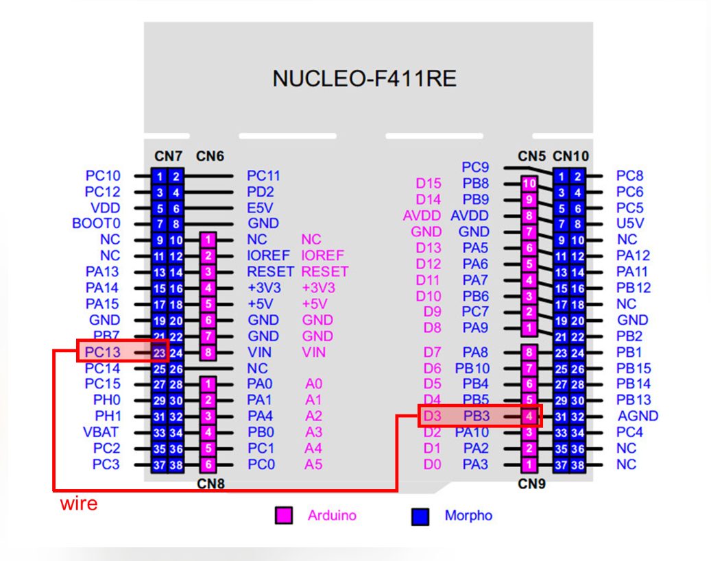
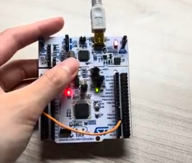
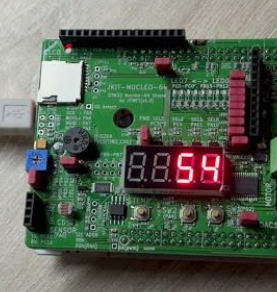

- # LAB: EXTI with SysTick

  **Date:** 2026-Oct-07

  **Author:** 유채은

  **Demo Video:** [problem0 video link](https://youtube.com/shorts/3LJtbuB2gRI)

  ​					 	[problem1 video link](https://youtube.com/shorts/GoG5pblliBw)

  **PDF version:** [LAB_EXTI_22200476.pdf](LAB_EXTI_22200476_YuChaeeun.pdf)

  ------

  ## Introduction

  In this lab, I built a 7-segment counter on the JKIT evaluation board using **External Interrupts (EXTI)** and the **SysTick timer** of the STM32F411RE.

  The goals of the lab were:

  1. Count up on the 7-segment display at a rate of **1 second**, timed by SysTick.
  2. **Reset** the count to zero when SW1 is pressed, using an external interrupt.
  3. **Pause / resume** the count when SW2 is pressed, using an external interrupt.
  4. (Challenge) Extend the counting range from **0–9** to **0–59** using two 7-segment digits.

  To do this, I wrote my own ecEXTI2 library and used it together with the ecRCC2, ecGPIO2, and ecSysTick2 libraries from the previous labs. A common initialization function `MCU_init()` in `ecSTM32F4v2.h` sets up the 84 MHz PLL clock and the 1 ms SysTick.

  ### Requirement

  **Hardware**

  - MCU: NUCLEO-F411RE
  - Eval Board: JKIT
  - Actuator/Sensor/Others: 7-segment display (on JKIT), push buttons SW1 and SW2 (on JKIT)

  **Software**

  - PlatformIO, CMSIS, EC_HAL library

  ------

  ## Problem 0: STM-Arduino

  ### Problem

  Turn the LED (LD2) on and off with the user button (BT1) on the NUCLEO-64 board, using an external interrupt in Arduino syntax instead of polling.

  ### Procedure

  1. Create a new Arduino program named `TU_arduino_EXTI.ino`.
  2. The user button is connected to `PC13`, which cannot be used directly in Arduino. Connect `PC13` to `D3` with a jumper wire.

  

  3. Write the code below and upload it.
  4. Compare the code with the one with polling method.

  ```c
  const int btnPin = 3;
  const int ledPin = 13;
  
  int btnState = HIGH;
  
  void setup() {
      pinMode(ledPin, OUTPUT);
      pinMode(btnPin, INPUT_PULLUP);
      attachInterrupt(digitalPinToInterrupt(btnPin), blink, CHANGE);
  }
  
  void loop() {
      // blank
  }
  
  void blink(){
      btnState = digitalRead(btnPin);
  
      if (btnState == HIGH)
          digitalWrite(ledPin, LOW);
      else
          digitalWrite(ledPin, HIGH);
  }
  ```

  ### Result

  The LED turns ON when the button is pressed (falling edge) and turns OFF when the button is released (rising edge). Because the trigger mode is `CHANGE`, the ISR runs on both edges.

  Compared with the polling version from LAB: GPIO, `loop()` is completely empty. The button is not checked repeatedly in the main loop. Instead, the hardware calls `blink()` only when the pin level changes.

  

  > 
  >
  > demo video: [problem0 video link](https://youtube.com/shorts/3LJtbuB2gRI)

  

  

  ------

  ## Problem 1: Counter on 7-Segment Display using EXTI

  ### Problem Description

  The program counts up on the 7-segment display once every second.

  - The count increases at a rate of 1 second, timed by the SysTick timer.
  - Pressing **SW1** resets the count to zero (EXTI).
  - Pressing **SW2** pauses the count. Pressing SW2 again resumes it (EXTI).
  - **Challenge (implemented):** the counting range is extended to **0–59** using two 7-segment digits. The count wraps back to 0 after 59.

  ### Procedure

  1. Connect the JKIT evaluation board to the NUCLEO-F411RE.

  2. Place the libraries in 

     ```
     EC\include\
     ```

     :

     - `ecRCC2.h`, `ecRCC2.c`
     - `ecGPIO2.h`, `ecGPIO2.c`
     - `ecSysTick2.h`, `ecSysTick2.c`
     - `ecEXTI2.h`, `ecEXTI2.c`
     - `ecSTM32F4v2.h`

  3. Create a new project under `EC\lab\` with the environment `LAB_EXTI` and the source file `LAB_EXTI.c`.

  4. Add the new environment to `platformio.ini`.

  5. Configure the GPIO pins and EXTI lines as shown in the table below.

  6. Build, upload, and test the counter, the reset button (SW1), and the pause button (SW2).

  

  ### Configuration

  | Function                           | Port - Pin                                                   | Configuration                                   |
  | ---------------------------------- | ------------------------------------------------------------ | ----------------------------------------------- |
  | **Button (SW1) on JKIT**           | PD_2                                                         | DIN, Pull-Up, EXTI2 (falling edge), priority 10 |
  | **Button (SW2) on JKIT**           | PA_4                                                         | DIN, Pull-Up, EXTI4 (falling edge), priority 10 |
  | **7-Segment DOUT**                 | PB_0, PB_1, PB_2, PB_3, PB_4, PB_5, PB_6, PB_7 ('a'~'g', 'dot', respectively) | Push-Pull, No Pull-up-Pull-down, Medium Speed   |
  | **Selection of 7-Segment Display** | PA_10 (FND_0), PA_11 (FND_1)                                 | DOUT, Push-Pull                                 |
  | **SysTick**                        | -                                                            | 1 ms interrupt, SYSCLK = 84 MHz (PLL)           |

  

  ------

  ## Code (LAB_EXTI.c)

  ### Program Structure

  The program is split into two parts.

  - **ISRs** (EXTI2_IRQHandler, EXTI4_IRQHandler) only change flags. They never touch the counter directly.

  - The main loop

     owns the counter. Every iteration, it does three independent jobs:

    1. **(A) Reset handling:** if a reset is requested, set the count to 0.
    2. **(B) 1-second update (non-blocking):** if 1000 ms have passed, increase the count (unless paused).
    3. **(C) Display refresh (multiplexing):** show the ones digit on FND0 and the tens digit on FND1, 1 ms each.

  | Variable     | Changed by                      | Meaning                                     |
  | ------------ | ------------------------------- | ------------------------------------------- |
  | `reset_flag` | SW1 ISR sets it, main clears it | **Event:** "please reset the count"         |
  | `pause_flag` | SW2 ISR toggles it              | **State:** 1 = paused, 0 = counting         |
  | `count`      | main only                       | current count (0–59)                        |
  | `prevTicks`  | main only                       | `msTicks` value at the last 1-second update |

  

  #### Global Flags

  ```c
  volatile int reset_flag = 0;    // event: 1 = reset requested
  volatile int pause_flag = 0;    // state: 1 = paused, 0 = counting
  ```

  These two flags are the only connection between the ISRs and the main loop. They are declared `volatile` because they are changed inside an ISR, which the compiler cannot see from the main loop. Without `volatile`, the compiler may keep the value in a CPU register, and the main loop would never see the change made by the ISR.

  ------

  ### code

  #### reset_led()

  Raises the reset request flag. It is called inside the SW1 interrupt handler.

  ```c
  void reset_led(void){
  
  	reset_flag = 1;
  }
  ```

  **Example code**

  ```c
  void EXTI2_IRQHandler(void) {
      if(is_pending_EXTI(SW1_PIN)){
          reset_led();              // request reset
          clear_pending_EXTI(SW1_PIN);
      }
  }
  ```

  ------

  #### pause_led()

  Toggles the pause state between 0 (counting) and 1 (paused). It is called inside the SW2 interrupt handler.

  ```c
  void pause_led(void){
  
      pause_flag ^= 1;      // 0 -> 1 -> 0 -> ...
  }
  ```

  **Example code**

  ```c
  void EXTI4_IRQHandler(void) {
  	if (is_pending_EXTI(SW2_PIN)) {
          pause_led(PA_10);              // toggle pause / resume
          clear_pending_EXTI(SW2_PIN);
  	}
  }
  ```

  ------

  ### main()

  #### Local variables

  ```c
  int i = 0;                  // ones digit
  int j = 0;                  // tens digit
  int count = 0;              // 0 ~ 59
  uint8_t display0 = 0;       // FND0: ones
  uint8_t display1 = 1;       // FND1: tens
  uint32_t prevTicks = 0;     // msTicks at last 1-second update
  ```

  Instead of counting the two digits separately, I use one variable `count` (0–59) and split it into digits. `prevTicks` is `uint32_t` like `msTicks`, so the subtraction `msTicks - prevTicks` stays correct even when `msTicks` wraps around.

  #### Reset handling and digit calculation

  ```c
  if(reset_flag == 1){        // SW1 pressed: reset count (only main changes count)
      count = 0;
      reset_flag = 0;         // clear the request
  }
  else{
      i = count % 10;         // ones digit
      j = count / 10;         // tens digit
  }
  ```

  When a reset is requested, the main loop sets `count` to 0 and clears the flag. The digits `i` and `j` are calculated from `count` on every loop, so the display follows `count` within a few milliseconds, even while paused.

  

  ------

  #### EXTI2_IRQHandler()

  Interrupt handler for SW1 (PD_2). It requests a reset and clears the pending bit.

  ```c
  void EXTI2_IRQHandler(void) {
      if(is_pending_EXTI(SW1_PIN)){
          reset_led();
          clear_pending_EXTI(SW1_PIN);
      }
  }
  ```

  SW1 is on pin 2, so it uses **EXTI line 2**. EXTI lines 0–4 each have their own IRQ, so the handler name must be `EXTI2_IRQHandler` to match the vector table.

  **Parameters**

  - None (called by hardware)

  **Example code**

  ```c
  EXTI_init(SW1_PIN, FALL, 10);   // enables EXTI2_IRQn -> this handler runs on SW1 press
  ```

  ------

  #### EXTI4_IRQHandler()

  Interrupt handler for SW2 (PA_4). It toggles the pause state and clears the pending bit.

  ```c
  void EXTI4_IRQHandler(void) {
  	if (is_pending_EXTI(SW2_PIN)) {
          pause_led();
          clear_pending_EXTI(SW2_PIN);
  	}
  }
  ```

  **Parameters**

  - None (called by hardware)

  **Example code**

  ```c
  EXTI_init(SW2_PIN, FALL, 10);   // enables EXTI4_IRQn -> this handler runs on SW2 press
  ```

  

  ------

  ## Results

  > 

  > demo video: [problem1 video link](https://youtube.com/shorts/GoG5pblliBw)

  

  ------

  ## Discussion

  ##### 1. Analyze the result and explain any other necessary discussion.

  The counter increases from 00 to 59 once every second, and SW1 and SW2 reset and pause the count through external interrupts. The key design choice was to replace `delay_ms(1000)` with a non-blocking `msTicks` check, because a 1-second blocking delay stopped the display multiplexing and only one digit was visible. I also made the ISRs only change flags, so that `count` is modified only in the main loop and no race condition can occur. One remaining limitation is that `prevTicks` is not reset when SW1 is pressed, so the 0 after a reset can be shown for less than one second. Another is that a mechanical button bounces for a few milliseconds, which can make the SW2 toggle fail. This could be fixed with an RC filter in hardware or by ignoring interrupts within a short time in software.

  

  ##### 2. We can use two different methods to detect an external signal: polling and interrupt. What are the advantages and disadvantages of each approach?

  Polling checks the input pin repeatedly in the main loop, so it is simple to write and easy to debug. However, it wastes CPU time, and its response depends on the loop period, so a long delay in the loop can delay or miss a short button press. An interrupt lets the hardware detect the edge and call the ISR immediately, regardless of what the main loop is doing. Its disadvantages are more setup (SYSCFG, EXTI, NVIC), harder debugging, and the need to handle shared variables carefully with `volatile` and flags. In this lab, the main loop was busy with timing and display refresh, so using interrupts kept the button handling independent and the code simpler.

  

  ##### 3. What would happen if the EXTI interrupt handler does not clear the interrupt pending flag? Check with your code.

  If the pending bit in `EXTI->PR` is not cleared, the interrupt request stays active after the ISR returns. The NVIC sees it again right away and re-enters the same ISR, and this repeats forever. As a result, the CPU never returns to the main loop, so the counter and the display refresh stop and the program looks frozen.

  

  

  ------

  ## Troubleshooting

  ##### 1. SW1 changed the display to 0, but the counting did not reset

  **Problem:** The reset function only showed 0 on the display. On the next loop, the old count appeared again.

  **Cause:** The reset function only called `FND_display(0)`. The counter was a local variable in `main()`, so the ISR could not change it.

  **Solution:** Use global `volatile` flags shared by the ISR and main. The ISR only sets `reset_flag`, and the main loop resets the count and clears the flag. This also prevents a race condition: if the ISR changed `count` directly in the middle of `count = (count + 1) % 60` (read → compute → write), the reset could be overwritten. I first tried to use `#define` for the counter, but `#define` is a preprocessor text replacement and has no memory, so it cannot be changed at run time.

  

  ##### 2. Pause was designed as a state, not a button press

  **Problem:** My first idea was "flag = 1 while the button is pressed", which would pause only while SW2 is held down.

  **Solution:** I treated `pause_flag` as a state ("paused or not") and toggled it with `pause_flag ^= 1` on every press. Unlike `reset_flag`, the main loop never clears it.

  

  ##### 3. Only one digit was visible when extending to 0–59

  **Problem:** With two digits, `delay_ms(1000)` at the end of the loop kept only the last selected digit ON for one second.

  **Cause:** Multiplexing needs the digits to be switched every few milliseconds, but the blocking 1-second delay stopped the loop.

  **Solution:** Change the 1-second update to a non-blocking check, `if ((msTicks - prevTicks) >= 1000)`, and move the display refresh outside of all conditions so that it runs every loop.

  

  ##### 4. Delayed reset and immediate increment after resume

  **Problem:** In an earlier version, the reset appeared on the display up to 1 second late, a reset during pause did not change the display, and the count increased immediately after resuming.

  **Cause:** `i`, `j`, and `prevTicks` were updated only inside the 1-second block, and only when not paused. During a pause, `msTicks - prevTicks` kept growing, so it was already over 1000 when counting resumed.

  **Solution:** Calculate `i` and `j` from `count` on every loop, so the display always follows `count`. Also update `prevTicks` every second regardless of the pause state.