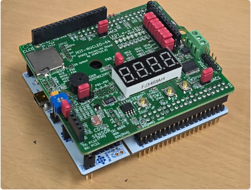
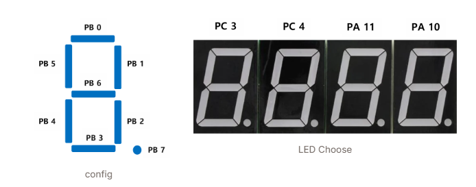
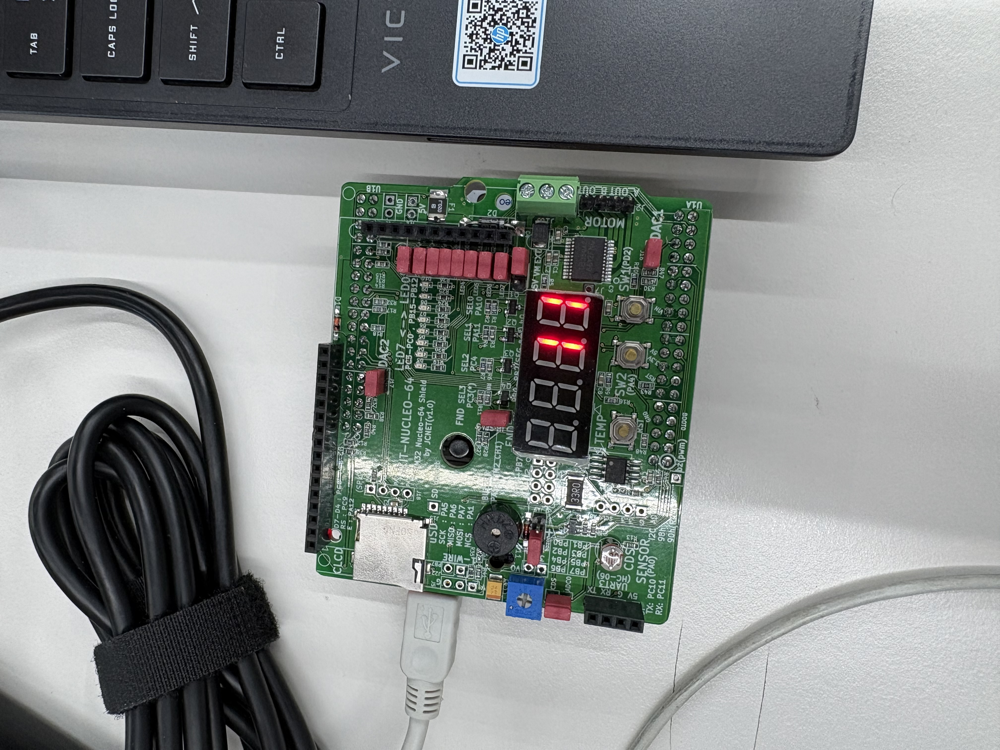
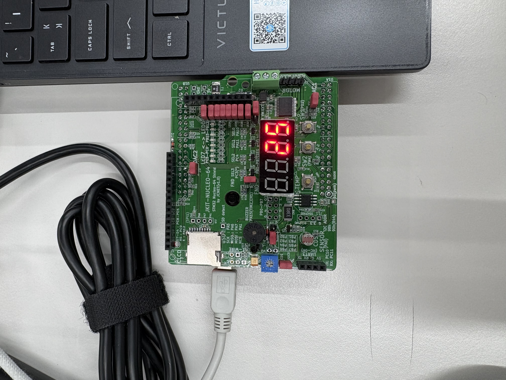
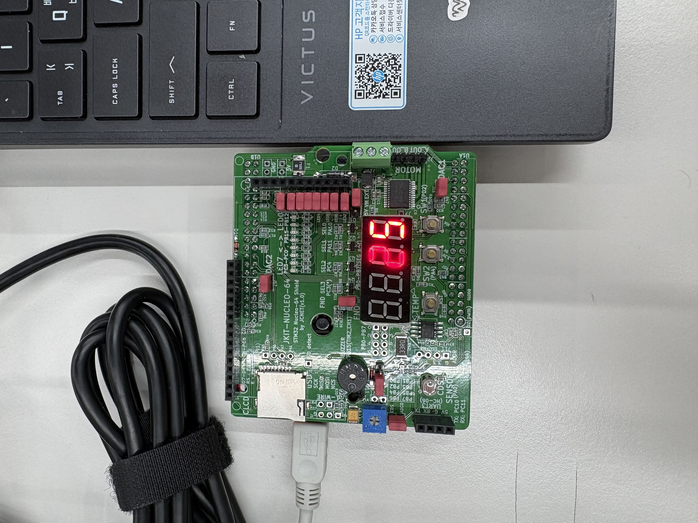
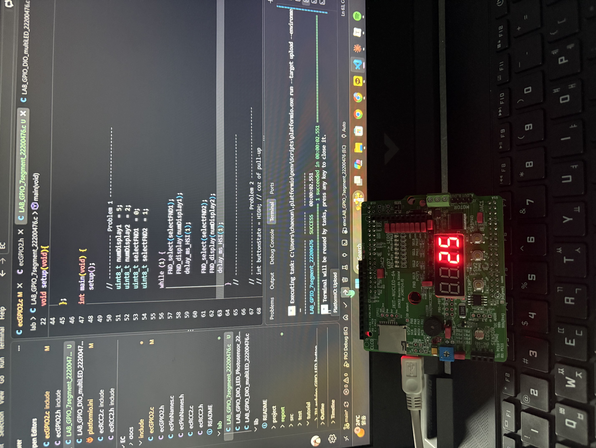
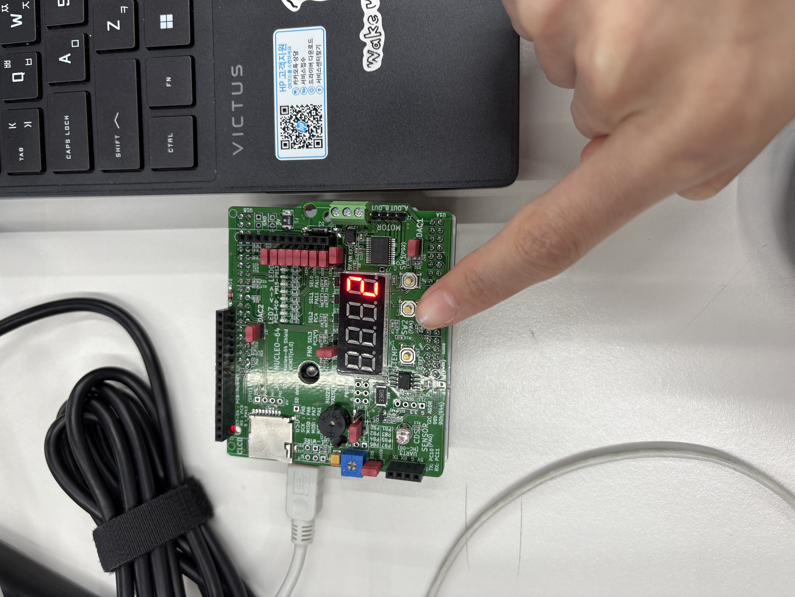

# LAB: GPIO 7-segment(eval board)

### LAB: GPIO 7-segment

**Date:** 2026-Sep-21

**Author/Partner:** 유채은

**PDF version:** [LAB_GPIO_7segment_22200476_YuChaeeun.pdf](./LAB_GPIO_7segment_22200476_YuChaeeun.pdf)


## Introduction

In this lab, you are required to create a simple program to control a 7-segment display to show a decimal number (0~9) that increases by pressing a push-button.

You must submit

- LAB Report (*.pdf)
- Zip source files(lab***.c, ecRCC2.h, ecGPIO2.h etc...).
  - Only the source files. Do not submit project files

**Requirement**

**Hardware**

- MCU
  - NUCLEO-F411RE
- Actuator/Sensor/Others:
  - eval board

**Software**

- PlatformIO, CMSIS, EC_HAL library

### Exercise

Fill in the table

| Port/Pin       | Description                  | Register setting                                             |
| -------------- | ---------------------------- | ------------------------------------------------------------ |
| Port B Pin 5   | Clear Pin5 mode              | GPIOB->MODER &=~(3<<(5*2))                                   |
| Port B Pin 5   | Set Pin5 mode = Output       | GPIOB->MODER \|= (1<<(5*2))                                  |
| Port B Pin 6   | Clear Pin6 mode              | GPIOB->MODER &=~(3<<(6*2))                                   |
| Port B Pin 6   | Set Pin6 mode = Output       | GPIOB->MODER \|= ( 1<<(6*2) )                                |
| Port B Pin Y   | Clear PinY mode              | GPIOB->MODER &=~(3<<(Y*2))                                   |
| Port B Pin Y   | Set PinY mode = Output       | GPIOB->MODER \|= ( 1<<(Y*2) )                                |
| Port B Pin 5~9 | Clear Pin5~9 mode            | GPIOB->MODER &=~(31<<(5*2))                                  |
|                | Set Pin5~9 mode = Output     | GPIOB->MODER \|= (341<<(5*2))                                |
| Port X Pin Y   | Clear Pin Y mode             | GPIOX->MODER &=~(3<<(Y*2))                                   |
|                | Set Pin Y mode = Output      | GPIOX->MODER \|= (1<<(Y*2))                                  |
| Port B Pin5    | Set Pin5 otype=push-pull     | GPIOB->OTYPER &= ~(1<<5)                                     |
| Port B PinY    | Set PinY otype=push-pull     | GPIOB-> OTYPER &= ~(1<<Y)                                    |
| Port B Pin5    | Set Pin5 ospeed=Fast         | GPIOB_OSPEEDR &= ~(3<<(5 **2))<br />GPIOB->OSPEEDR \|= (2<<(5* *2)) |
| Port B PinY    | Set PinY ospeed=Fast         | GPIOB_OSPEEDR &= ~(3<<(5*2))<br />GPIOB-> OSPEEDR \|= (2<<(Y *2)) |
| Port B Pin 5   | Set Pin5 PUPD=no pullup/down | GPIOB->PUPDR &= ~(3<<(5*2))                                  |
| Port B Pin Y   | Set PinY PUPD=no pullup/down | GPIOB-> PUPDR &= ~(3<<(Y*2))                                 |


## Problem 1. Library for 7-segment display on JKIT Board

#### Problem

There are four 7-Segment Displays on JKIT board.

- You need to select which one to use.
- There is no BCD decoder
- JKIT - Nucleo 64: [link](https://www.devicemart.co.kr/goods/view?no=14123215&srsltid=AfmBOooT3zgaxGXZ_q0fvy4uZxHesTbwpqNprE6P3YXMk9V0EGoGrhLM)


Complete the required functions that displays numbers on 7-segment FND.(JKIT - Nucleo 64)

These functions are defined and declared in `ecGPIO2.h,ecGPIO2.c`





```c
// Display a number 0 - 9 only
void FND_display_init(PinName_t *pinFND);
void FND_display(uint8_t  num)

// Select display: FND0 to FND3
void FND_select_init(PinName_t *selectFND);
void FND_select(uint8_t select);
```

Display a decimal number: 0~9 on each and all FNDs


If you want to display multiple 7-segment displays at the same time, you need to use a very short delay to select multiple numbers iteratively


**Check if the 7-segments display are Common Anode or Cathode**

**For Common Cathode: Giving 'High' to the pin -> LED ON**

#### Procedure

1. Connect the evaluation board [(JKIT-NUCLEO) ](https://ykkim.gitbook.io/ec/ec-course/hardware/stm32f-evaluation-board#reference-manual)to the MCU.
2. Make sure that your library **ecGPIO2.h, ecGPIO2.c** are in `EC\include\`.
3. Create a new project under the directory `EC\lab\`

- Environment: “**LAB_GPIO_7segment”**
- Source File: ““**LAB_GPIO_7segment.c”**

1. You must modify the `**platformio.ini**` **,** to add new environment.

> You MUST write your name in the top of the source file, inside the comment section.

**Configuration**




| Function                           | Port - Pin                                     | Configuration                 |
| ---------------------------------- | ---------------------------------------------- | ----------------------------- |
| **Selection of 7-Segment Display** | PA_10, PA_11, PC_4, PC_3 (FND_0~FND_3)         | DOUT, Push-Pull               |
| **7-Segment LEDs**                 | PB_0, PB_1, PB_2, PB_3, PB_4, PB_5, PB_6, PB_7 | DOUT, Push-Pull, Medium Speed |


### code

##### FND_display()

Display a number (0 - 9)

```c
void FND_display(uint8_t num){
	if(num > 9){
		num = 10;   // error: print dot
	}
	for(int i=0; i<8; i++){
		GPIO_write(_fndPins[i], numberFND[num][i]);
	}
}
```

**parameter**

- num: the number(0 - 9) you want to display (* not a pin number!!)

**example code**

```c
uint8_t numDisplay1  = 5;
FND_display(numDisplay1);
```


##### FND_select()

choose the displays you want to show numbers (out of display 0, 1, 2, 3)

```c
// Select display: FND0 to FND3
void FND_select(uint8_t digit){
	for(int i=0; i<4; i++){
		GPIO_write(_fndSel[i], (digit == i) ? HIGH : LOW);
	}	
}
```

**parameter**

- digit: the index of display you want to choose

**example code**

```c
uint8_t selectFND2  = 1;
FND_select(selectFND2);
```


#### Results

Experiment images and results

> Show experiment images /results
>
> I chose the first and the second displays to show different numbers.
>
> <figure>
>     <div style="text-align:center">
>         
> 	     <p><i>number 11</i></p>
> 	</div>
> </figure>
>
> 
>
> <figure>
>     <div style="text-align:center">
>           
> 	     <p><i>number 25 (with delay 10ms)</i></p>
> 	</div>
> </figure>
>
>   <figure>
>     <div style="text-align:center">
>         
> 	     <p><i>number 25 (with delay 1ms)</i></p>
> 	</div>
> </figure>
>
> 


[demo video link] https://youtube.com/shorts/MMUgY9jgyQ0


#### Analysis

> Problem 1 is about displaying numbers from 0 to 9 and going back to 0 again after 9 by controlling GPIO pins corresponding to each segment(a~g, dp) of 7-segment display(FND). 
>
> When I set the delay to 1 ms, both 7-segment displays appeared to be turned on simultaneously to the naked eye; however, due to ghosting (bleeding), it was difficult to recognize the numbers when captured on camera. Increasing the delay to 10 ms significantly alleviated this ghosting effect, but it introduced visible flickering, making the alternating transition between the two digits noticeable. This can be analyzed as the result of a reduced refresh rate failing to satisfy the human eye's persistence of vision as the time interval between sequentially activating each digit increased. When photographed, one of the digits was often completely missing in the capture; this is explained by the camera shutter capturing a much shorter duration than the human eye, thereby missing the digit that was turned off at that exact instant. 
>
> Nevertheless, even when it was clearly visible to the naked eye, capturing it on camera yielded similar ghosting issues that hindered visibility. Instead, turning off the room lights to darken the environment made the display clearly visible on camera, even with a 1 ms delay.


------

## Problem 2: Counter with Button Press

#### Procedure

Create a code that increases the displayed number from 0 to 9 with each button press.

- After the number '9', it should start from '0' again.
- Modify from Problem 1 source code

#### Configuration

Configure the MCU GPIO

| Function                           | Port - Pin                                                   | Configuration                                 |
| ---------------------------------- | ------------------------------------------------------------ | --------------------------------------------- |
| **Button (SW2) on JKIT**           | PA_4                                                         | DIN, Pull-Up                                  |
| **7-Segment DOUT**                 | PB_0, PB_1, PB_2, PB_3, PB_4, PB_5, PB_6, PB_7<br />('a'~'g''dot', respectively) | Push-Pull, No Pull-up-Pull-down, Medium Speed |
| **Selection of 7-Segment Display** | PA_10 (FND_0)                                                | DOUT, Push-Pull                               |

*** Challenge : Extend the display number from 0 to 19**


### code

Your code goes here:

##### main()

Increase number from 0 to 9, and then 0 again every time pressing the button.

```c
while(1){

        FND_select(selectFND3);
        buttonState = GPIO_read(BUTTON_PIN);
		// display 7-segment 0 to 9
		// increase number with button push
		if(buttonState == LOW && prev_buttonState == HIGH) {
            FND_display(i);
			i = (i + 1) % 10;
            delay_ms_HSI(1);
		}
        prev_buttonState = buttonState;
		delay_ms_HSI(50);
	}
```


#### Results

Experiment images and results

> <figure>
>     <div style="text-align:center">
>         
> 	     <p><i>Picture of the display</i></p>
> 	</div>
> </figure>


[demo video link] https://youtube.com/shorts/yTl8t-weMtg


#### Discussion

1. Analyze the result and explain any other necessary discussion.

> In Problem 2, falling edge detection (`buttonState == LOW && prev_buttonState == HIGH`) was implemented to ensure the number increments by exactly 1 per button press. Had the button's pressed state (`LOW`) alone been used as the condition, the loop would have iterated multiple times even during a brief press, causing the number to increase continuously. Furthermore, experimental results showed no malfunctions due to contact bounce, even without dedicated debouncing logic; this can be analyzed as the 50 ms delay set for the button polling period being sufficiently longer than the mechanical switch bouncing duration (a few to 20 ms), effectively bypassing the bounce transient and sampling only the stabilized signal.

2. What are the common cathode and common anode of 7-segment display?

> In a 7-segment display, common cathode and common anode differ in how the LEDs are wired. In common cathode, the cathodes of all LED segments are tied together and connected to ground. Therefore, the corresponding anode pin must be driven high to turn on a segment. In common anode, on the other hand, the anodes of all LEDs are tied together and connected to Vcc. Therefore, the cathode pin must be driven low to turn on a segment.

3. Does the LED of a 7-segment display (common anode) pin turn ON when 'HIGH' is given to the LED pin from the MCU?

> Since this 7-segment display is common anode, the anodes of the LEDs are tied together to Vcc. Therefore, to turn it on, the cathode pin of the LED must be driven low.

4. How can we display 4 digit-numbers on the 4 FNDS at the same time? How to remove ghosting of displaying a number?

> Run an infinite loop with a while statement, and inside it, display each digit in turn with a delay of a few ms in between. By alternating through the four digits at a very high speed, our eyes perceive all four numbers as being lit at the same time. However, because the alternating happens so fast, ghosting occurs. If the delay is increased so that the alternating becomes slower than before, the ghosting is reduced. But as a trade-off, the four digits start to appear as if they are flickering, meaning the alternating becomes visible to the naked eye.