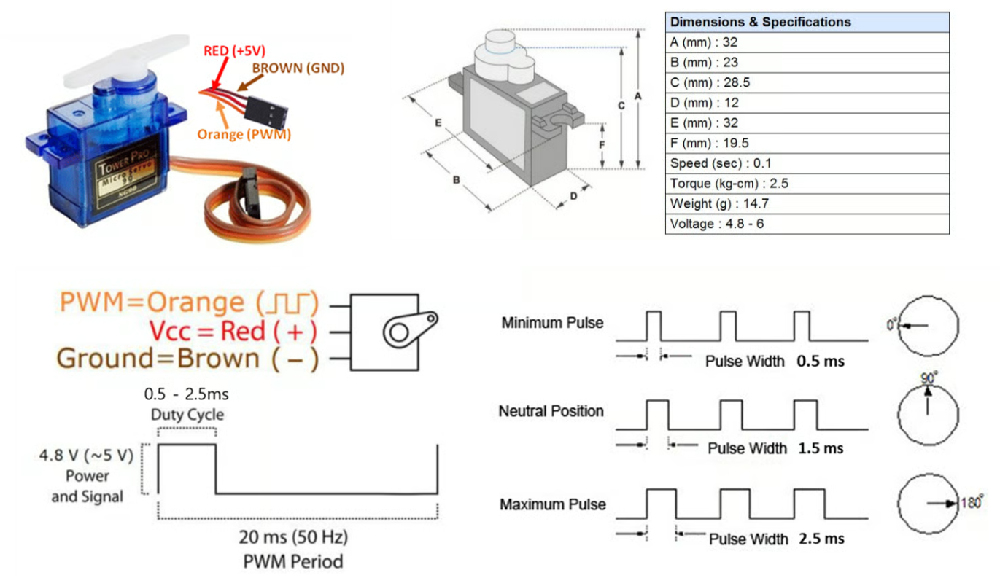
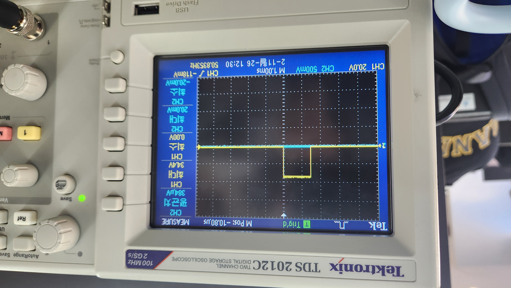
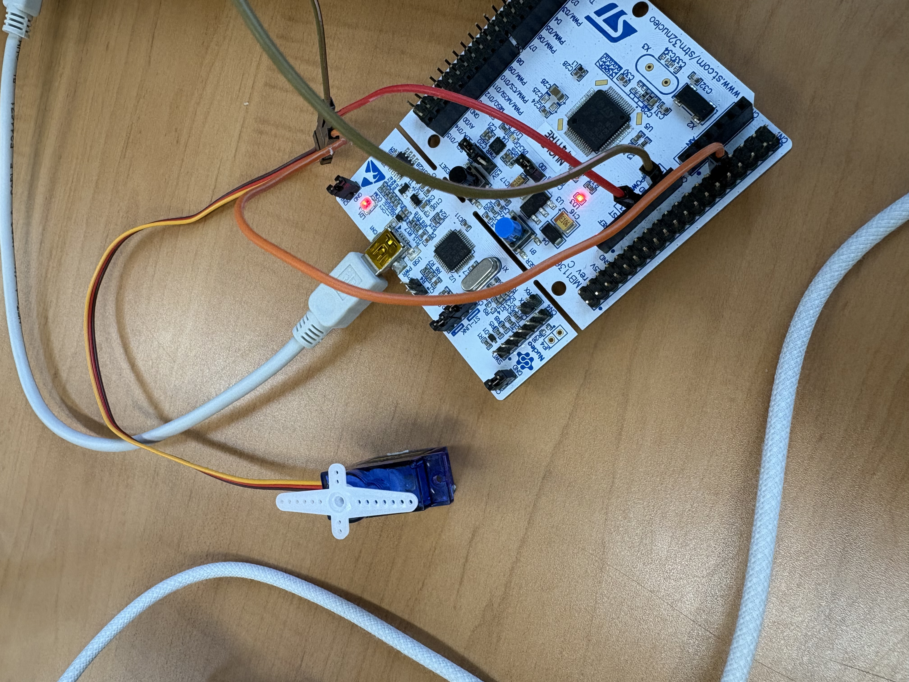
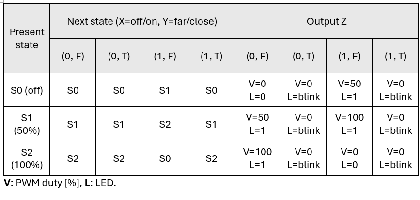
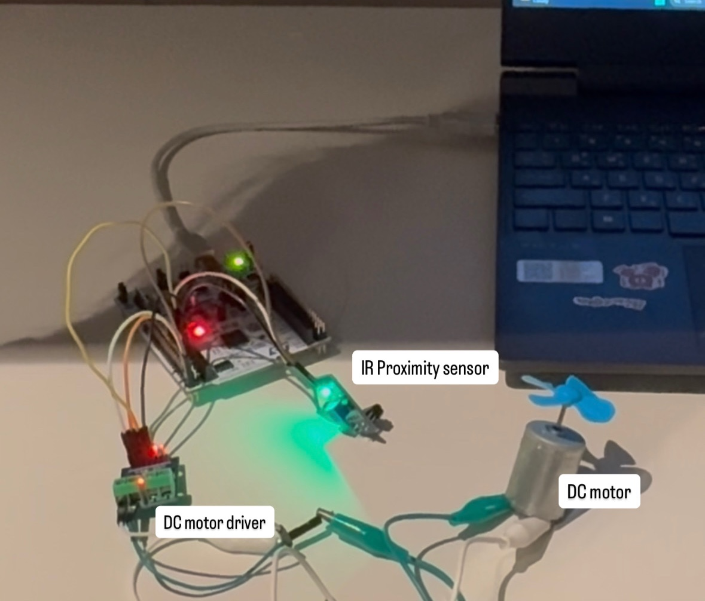
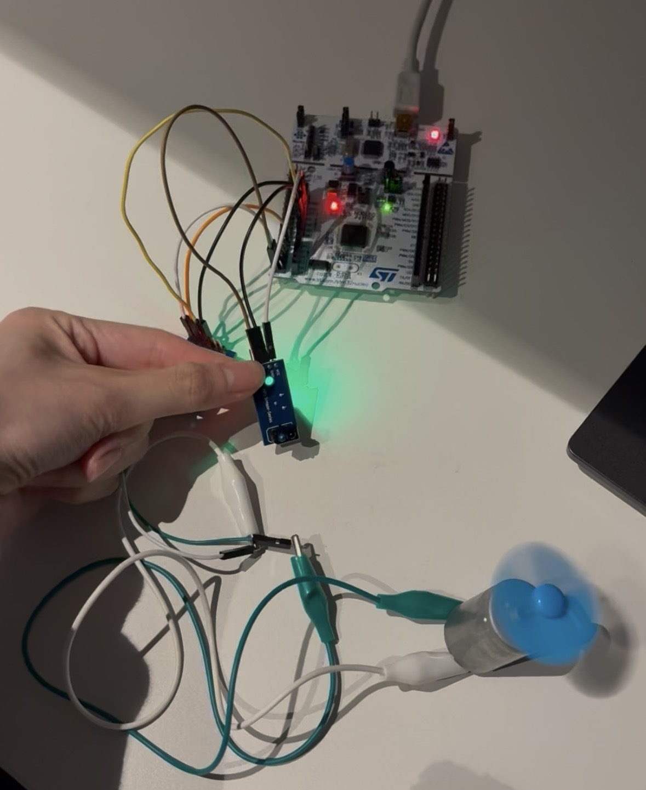
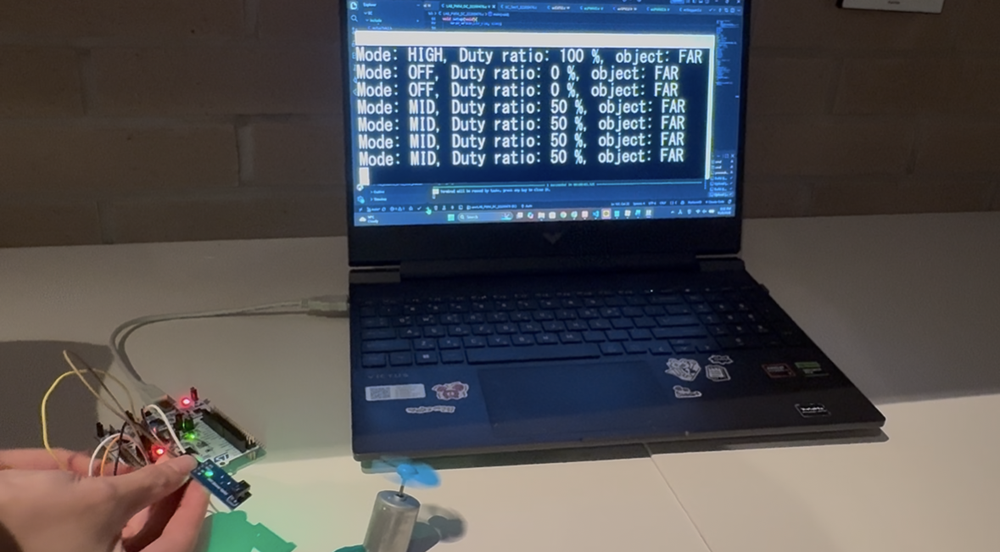

# LAB: Timer & PWM

**Date:** 2026-Nov-08

**Author:** Yu Chaeeun (22200476)

**Demo Video:**  [LAB_PWM_RC](https://youtube.com/shorts/WjzcMk2h8w0)

​						  [LAB_PWM_DC](https://youtu.be/kq4sLe1f25g)

**PDF version:** [LAB_PWM_22200476_YuChaeeun](LAB_PWM_22200476_YuChaeeun.pdf)


## Introduction

In this lab, the PWM output function of the STM32F411 general-purpose timers is used to drive actuators.

- **Problem 1** controls the angle of an RC servo motor (SG90). TIM2 generates a 50 Hz PWM signal, and the servo angle is set by changing the pulse width of that signal. A TIM3 update interrupt (500 ms) changes the angle step by step, and an external interrupt (EXTI) on the user button resets the angle to 0°.
- **Problem 2** controls the speed of a DC motor (mini-fan) with PWM, using an FSM-based design.

### Requirement

**Hardware**

- MCU
  - NUCLEO-F411RE
- Actuator/Sensor/Others:
  - RC Servo Motor (SG90)
  - DC motor (5V)
  - DC motor driver(LS9110s or L298N)

**Software**

- PlatformIO, CMSIS, EC_HAL library

------

## Problem 1: RC servo motor

An RC servo motor is a lightweight motor with high output torque for its size. It is used to control the rotation angle within approximately 180° and is commonly used in RC cars and small robots. Inside the servo, a DC motor, a gear train, and a potentiometer form a closed-loop position control system. The servo takes the pulse width of the PWM input as the reference angle and drives the motor until the measured angle matches it. The PWM period is 20 ms (50 Hz).




### Problem Description

The servo motor rotates back and forth between 0° and 180° within a given period of time.

- The servo signal line is connected to PA1, which is the PWM output of TIM2_CH2. The servo is powered from its supply (VCC) and shares a common ground with the MCU.
- A TIM3 update interrupt with a period of 500 ms is used as the time base.
- The angle increases from 0° to 180° with a step of 10° every 500 ms. After reaching 180°, it decreases back to 0°, and this repeats. (Timer interrupt IRQ)
- When the user button (PC13) is pressed, the angle is reset to 0° and the motion starts over. (EXTI)

### Procedure

1. A new environment **`LAB_PWM_RC`** was added to `platformio.ini`.
2. The source file **`LAB_PWM_RC_22200476.c`** was created, with the author's name in the header comment.
3. The PWM output was checked with an oscilloscope, including how the output changes when the button is pressed.

#### Configuration

| Type                       | Port - Pin     | Configuration                                         |
| -------------------------- | -------------- | ----------------------------------------------------- |
| **Button**                 | PC13           | DIN, Pull-Up, EXTI13 (falling edge), NVIC priority 10 |
| **PWM**                    | TIM2_CH2 (PA1) | TIM2 (PWM) period: 20 msec, Pulse width: 0.5~2.5 msec |
| **Timer Update Interrupt** | TIM3           | TIM3: Timer Interrupt of 500 msec, NVIC priority 2    |


#### Pulse Width – Angle Mapping

Based on the lab specification, the pulse width range is 0.5 ms (0°) to 2.5 ms (180°). The total range of 180° is divided into steps of 10°:
$$
\text{MAX_STEP} = \frac{180^\circ}{10^\circ} = 18
$$
The pulse width for each step is a linear mapping:
$$
pw,[\mu s] = 500 + \frac{(2500 - 500)\times \text{step}}{18}, \quad \text{step} = 0, 1, \dots, 18
$$


| step | Angle | Pulse width (calculated) | Duty ratio (20 ms period) |
| ---- | ----- | ------------------------ | ------------------------- |
| 0    | 0°    | 500 µs                   | 2.5 %                     |
| 1    | 10°   | 611 µs                   | 3.06 %                    |
| 9    | 90°   | 1500 µs                  | 7.5 %                     |
| 18   | 180°  | 2500 µs                  | 12.5 %                    |

One step corresponds to 2000 / 18 ≈ 111.1 µs, which is not an integer. The multiplication is done before the division, so integer truncation happens only once per calculation. Because the pulse width is recalculated from `step` every time instead of being accumulated, the truncation error does not build up (step 9 gives exactly 1500 µs, and step 18 gives exactly 2500 µs).

#### Code

The program uses an interrupt-driven structure. After initialization, `main()` stays in an empty idle loop. All the work is done in two ISRs:

- **TIM2** generates the 50 Hz PWM waveform in hardware, without CPU involvement.
- **TIM3** creates an update event every 500 ms. Its ISR outputs the pulse width for the current step and updates `step` and `dir`.
- **EXTI13** (PC13 button) resets `step` and `dir` and immediately sets the output to 0°.

The full source file is shown below, divided into parts.

------

##### 1. Header and Definitions

The header comment gives the author and a description of the program. The header files for the MCU and the EC library are included. Pin names and servo parameters are defined as macros, so the step size or the pulse width range can be changed in one place. `MAX_STEP` is wrapped in parentheses because a macro is replaced as text. Without the parentheses, `x / MAX_STEP` would become `x / 180 / 10`.

```c
#include "stm32f411xe.h"
#include "ecSTM32F4v2.h"

#define     PWM_RC       PA_1
#define     BUTTON_PIN   PC_13
#define     MAX_US       2500      // 180[deg]
#define     MIN_US       500       // 0[deg]
#define     ANGLE_MAX    180
#define     MOVE_BY      10     // [deg]  <----------------- MODIFY
#define     MAX_STEP     (ANGLE_MAX / MOVE_BY)
```

| Macro        | Value   | Description                                                  |
| ------------ | ------- | ------------------------------------------------------------ |
| `PWM_RC`     | `PA_1`  | PWM output pin to the servo (TIM2_CH2)                       |
| `BUTTON_PIN` | `PC_13` | User button pin (EXTI13)                                     |
| `MAX_US`     | 2500    | Pulse width for 180° [µs]                                    |
| `MIN_US`     | 500     | Pulse width for 0° [µs]                                      |
| `ANGLE_MAX`  | 180     | Maximum angle [°]                                            |
| `MOVE_BY`    | 10      | Angle change per step [°]. 180 should be divisible by this value. |
| `MAX_STEP`   | 18      | Number of steps from 0° to 180°                              |

------

##### 2. Global Variables

These variables keep the state of the motion between interrupts. They are shared by `TIM3_IRQHandler()` and `EXTI15_10_IRQHandler()`, so they are declared `volatile`. This makes the compiler read them from memory every time. `step` is a signed type (`int32_t`) because it is decreased during the down motion. With an unsigned type, `0 - 1` would wrap around to 4,294,967,295, and a condition such as `step < 0` would always be false.

```c
volatile int32_t step = 0;
volatile uint8_t dir = 1;     // dir=1:up, dir=0:down
```

| Variable | Type               | Initial value | Description                              |
| -------- | ------------------ | ------------- | ---------------------------------------- |
| `step`   | `volatile int32_t` | 0             | Current step index (`0` ~ `MAX_STEP`)    |
| `dir`    | `volatile uint8_t` | 1             | Direction of motion (`1`: up, `0`: down) |

------

##### 3. `pw_direction()` : Step → Pulse Width

Converts a step index into the PWM pulse width in µs, using a linear mapping between `MIN_US` (0°) and `MAX_US` (180°). The multiplication `(MAX_US - MIN_US) * step` is done before the division by `MAX_STEP`, so integer truncation happens only once.

```c
uint32_t pw_direction(int32_t step){
    uint32_t pw = 0;    // us
    
    pw = MIN_US + ((MAX_US - MIN_US) * step) / MAX_STEP ;

    return pw;
}
```

- **Input:** `int32_t step` – step index (`0` ~ `MAX_STEP`)

- **Output:** `uint32_t` – pulse width [µs] (`MIN_US` ~ `MAX_US`)

- Example:

  ```c
  PWM_pulsewidth_us(PWM_RC, pw_direction(9));   // step 9 -> 1500 us -> 90°
  ```

------

##### 4. `setup()` : Initialization

Initializes the system clock, SysTick, GPIO, PWM, timer interrupt, and EXTI, in this order:

1. `RCC_PLL_init()`: sets SYSCLK to 84 MHz using the PLL
2. `SysTick_init()`: sets a 1 ms SysTick
3. `GPIO_init()`, `GPIO_pupd()`: sets PC13 as a digital input with pull-up
4. `PWM_init(PWM_RC, 20)`: sets TIM2_CH2 (PA1) as a 20 ms period PWM output
5. `PWM_pulsewidth_us(PWM_RC, 500)`: sets the initial angle to 0°
6. `TIM_UI_init_ms(TIM3, 500)`: sets TIM3 to generate an update interrupt every 500 ms
7. `EXTI_init(BUTTON_PIN, FALL, 10)`: sets EXTI on PC13 with falling-edge trigger and NVIC priority 10

```c
// Initialization
void setup(void){
    RCC_PLL_init();     // CLOCK PLL 84MHz
    SysTick_init();     // SysTick 1msec

    // button-pin
    GPIO_init(BUTTON_PIN, INPUT);
    GPIO_pupd(BUTTON_PIN, PULL_UP);

    // PWM of 20 msec:  TIM2_CH2 (PA_1) 
    PWM_init(PWM_RC, 20);          // 20 msec period -> 50 Hz 
    PWM_pulsewidth_us(PWM_RC, 500);    // 0.5 msec

    // TIM3 Update-Event Interrupt every 500 msec
    TIM_UI_init_ms(TIM3, 500);           // UEV every 500 msec

    // Initialize EXTI PC_13
    EXTI_init(BUTTON_PIN, FALL, 10);	

}
```

- **Input:** none

- **Output:** none

- Example:

  ```c
  int main(void){    setup();    while(1){}}
  ```

------

##### 5. `main()` : Idle Loop

The program entry point. It calls `setup()` and then stays in an infinite idle loop while the ISRs do the work. The loop prevents `main()` from returning. On bare-metal there is no OS to return to, so the behavior after returning would depend on the startup code.

```c
int main(void) {  // ----------------- main --------------------
    // Initialization 
    setup();

    while(1){}

} // -------------- end main ------------------
```

- **Input:** none
- **Output:** none (never returns)
- **Example:** Called automatically by the startup code (`Reset_Handler`) after reset.

------

##### 6. `TIM3_IRQHandler()` : Angle Update Every 500 ms

Called every 500 ms by the TIM3 update event. It outputs the pulse width for the current step and updates the step for the next interrupt, so that the servo moves back and forth between 0° and 180° in 10° steps.

1. Checks the update interrupt flag with `is_UIF(TIM3)`.
2. Up motion (`dir == 1`): outputs the current step, then `step++`. If `step` exceeds `MAX_STEP`, it sets `dir = 0` and `step = MAX_STEP - 1`, so the next output is 170°.
3. Down motion (`dir == 0`): outputs the current step, then `step--`. If `step` goes below 0, it sets `dir = 1` and `step = 1`, so the next output is 10°.
4. Clears the flag with `clear_UIF(TIM3)`. Without this, the ISR would be entered again repeatedly.

```c
// TIM3 Update Interrupt Handler - increase by 10°
void TIM3_IRQHandler(void){

    if(is_UIF(TIM3)){           // Check UIF(update interrupt flag)

        if(dir == 1){       // dir: up
            PWM_pulsewidth_us(PWM_RC, pw_direction(step));
            step++;
            if(step > MAX_STEP){        // update dir, step if it goes out of boundary
                dir = 0;
                step = MAX_STEP - 1;
            }
        }
        else if (dir == 0){     // dir: down
            PWM_pulsewidth_us(PWM_RC, pw_direction(step));
            step--;
            if(step < 0){
                dir = 1;
                step = 1;
            }
        }
        clear_UIF(TIM3);        // Clear TIM_UI flag
    }
}
```

- **Input:** none (ISR). Reads the global variables `step` and `dir`.
- **Output:** none (ISR). Updates `step` and `dir`, and sets the PWM pulse width of PA1.
- **Example:** Called automatically by the NVIC when the TIM3 update event occurs. It must be named exactly `TIM3_IRQHandler` to match the vector table.

Trace near the boundaries:

| Interrupt | dir (before) | Output step (angle) | step (after) | dir (after) |
| --------- | ------------ | ------------------- | ------------ | ----------- |
| n         | 1            | 17 (170°)           | 18           | 1           |
| n+1       | 1            | 18 (180°)           | 19 → 17      | 0           |
| n+2       | 0            | 17 (170°)           | 16           | 0           |
| m         | 0            | 1 (10°)             | 0            | 0           |
| m+1       | 0            | 0 (0°)              | −1 → 1       | 1           |
| m+2       | 1            | 1 (10°)             | 2            | 1           |

The output step always stays within 0 ~ 18, and each end angle is held for only 500 ms.

------

##### 7. `EXTI15_10_IRQHandler()` : Button Reset

Called when the user button (PC13) is pressed. It resets the servo to 0° and restarts the up motion.

1. Checks the pending bit of EXTI13 with `is_pending_EXTI(BUTTON_PIN)`. EXTI lines 10 to 15 share one IRQ, so the pending bit must be checked.
2. Sets `step = 0`, outputs the 0° pulse width immediately, and sets `dir = 1`.
3. Clears the pending bit with `clear_pending_EXTI(BUTTON_PIN)`.

```c
void EXTI15_10_IRQHandler(void) {

	if (is_pending_EXTI(BUTTON_PIN)) {   // EXTI_BUTTON_PIN : reset the servo motor to 0°
			step = 0 ;

            PWM_pulsewidth_us(PWM_RC, pw_direction(step));
            dir = 1;
            clear_pending_EXTI(BUTTON_PIN);
	}
}
```

- **Input:** none (ISR)
- **Output:** none (ISR). Sets `step = 0`, `dir = 1`, and the PWM pulse width of PA1 to 500 µs (0°).
- **Example:** Called automatically by the NVIC on a falling edge of PC13 (the button is active-low because of the pull-up).


------

#### Results

> 
>
> 
>
> The PWM period measured on the oscilloscope was 20 ms (50 Hz) for all angles, and only the pulse width changed. The servo moved in 10° steps every 500 ms from 0° to 180° and back. When the button was pressed, the pulse width immediately returned to 0.5 ms, and the motion started over from 0°.
>
> 
>
> Demo video: [LAB_PWM_RC](https://youtube.com/shorts/WjzcMk2h8w0)
>


#### Discussion

**1. Derive a simple logic to calculate CCR and ARR values to generate x[Hz] and y[%] duty ratio of PWM. How can you read the values of input clock frequency and PSC?**

The timer counter clock is the timer input clock divided by the prescaler:
$$
f_{cnt} = \frac{f_{CK_PSC}}{PSC + 1}
$$
The counter counts from 0 to ARR, so the PWM period is (ARR + 1) counts:
$$
f_{PWM} = \frac{f_{cnt}}{ARR + 1} = x \quad\Rightarrow\quad ARR = \frac{f_{cnt}}{x} - 1
$$
In PWM mode 1 (up-counting), the output is high while CNT < CCR, so the duty ratio is CCR / (ARR + 1):
$$
\frac{y}{100} = \frac{CCR}{ARR + 1} \quad\Rightarrow\quad CCR = \frac{y}{100},(ARR + 1)
$$
PSC should be chosen first, so that ARR fits in the counter (16-bit for TIM3/TIM4, 32-bit for TIM2/TIM5) and so that ARR + 1 is large enough for the required duty resolution.

*Example (this lab):* f_CK_PSC = 84 MHz, PSC = 83 → f_cnt = 1 MHz. For x = 50 Hz, ARR = 1,000,000 / 50 − 1 = 19999. For a 1.5 ms pulse (y = 7.5 %), CCR = 0.075 × 20000 = 1500.

*Reading the input clock and PSC:*

- **PSC** can be read directly from the `TIMx->PSC` register. The library does this in `PWM_pulsewidth_us()`: `f_cnt = EC_SYSCLK / (TIMx->PSC + 1)`.
- **Input clock:** The timer clock comes from SYSCLK → AHB prescaler (`HPRE`) → APB prescaler (`PPRE1` for APB1, `PPRE2` for APB2) in `RCC->CFGR`. TIM2 to TIM5 are on APB1. If the APB prescaler is not 1, the timer clock is twice the APB clock. In this lab, SYSCLK = 84 MHz from the PLL. APB1 is divided by 2 because 84 MHz is above the APB1 limit, but the timer clock is doubled back to 84 MHz. In software, the system clock can be read from `SystemCoreClock` (CMSIS, after `SystemCoreClockUpdate()`) or from the library macro `EC_SYSCLK`. The prescaler settings can be read from `RCC->CFGR`. All of these registers can also be checked in the debugger's peripheral register view.

**2. What is the smallest and highest PWM frequency that can be generated for Q1?**

For Q1, TIM2 is used. It has a 32-bit counter (ARR up to 2³² − 1), a 16-bit prescaler (PSC up to 65535), and f_CK_PSC = 84 MHz.
$$
f_{PWM} = \frac{84,\text{MHz}}{(PSC + 1)(ARR + 1)}
$$


- **Highest (hardware limit):** PSC = 0, ARR = 1 (ARR must be at least 1 for the counter to count).
  $$
  f_{max} = \frac{84,\text{MHz}}{1 \times 2} = 42,\text{MHz}
  $$
  At this frequency only 0 %, 50 %, or 100 % duty ratios are possible. For a 1 % duty resolution, ARR + 1 must be at least 100, so the maximum becomes 840 kHz. The GPIO output speed setting also limits how clean the edges are at high frequencies.

- **Lowest (hardware limit):** PSC = 65535, ARR = 2³² − 1.
  $$
  f_{min} = \frac{84,\text{MHz}}{65536 \times 2^{32}} \approx 2.98 \times 10^{-7},\text{Hz}
  $$
  This is a period of about 3.35 × 10⁶ s (≈ 38.8 days).

- **With the EC library functions used in this lab:** For TIM2, `PWM_init()` / `PWM_init_us()` always use `TIM_init_us()`, which fixes f_cnt = 1 MHz (PSC = 83).

  - Highest: `PWM_init_us()` limits the period to at least 10 µs → 100 kHz
  - Lowest: ARR = 2³² − 1 → 1 MHz / 2³² ≈ 2.33 × 10⁻⁴ Hz (period ≈ 4295 s ≈ 71.6 min)

**3. Additional discussion**

- **Integer arithmetic and resolution:** `PWM_pulsewidth()` takes the pulse width as an integer in ms, so 0.5 ms would be truncated to 0. `PWM_pulsewidth_us()` was used instead. Using a smaller unit (µs) keeps integer arithmetic while giving 1 µs resolution, which matches the 1 µs tick of TIM2 (f_cnt = 1 MHz). For the servo, 1 µs ≈ 0.09°.
- **Boundary handling:** The ISR outputs the current step first and then updates it. When `step` goes past a boundary, `dir` is reversed and `step` is moved to the next value in the new direction (`MAX_STEP − 1` or `1`). As shown in the trace table, no out-of-range pulse width is ever output, and the end angles are held for only 500 ms. The `>` / `<` checks (instead of `==`) also recover safely if `step` ever goes out of range. For example, if the TIM3 ISR (priority 2) preempts the EXTI ISR (priority 10) between `step = 0` and `dir = 1`, the ISR sees step = −1 and corrects it.
- **Interrupt priority:** TIM3 (priority 2) has a higher priority than EXTI (priority 10) in the NVIC, where a lower number means a higher priority. So a button press during the TIM3 ISR is handled right after the TIM3 ISR finishes.
- **Limitation:** Because the ISR outputs the current step before updating it, 0° is held for about 1 s at power-up. This happens because `setup()` outputs 0° and the first TIM3 interrupt outputs step 0 again. In the same way, after a button press, 0° is held until the next TIM3 interrupt plus one more period (500 ~ 1000 ms). Changing the order to "update, then output" would remove this delay.
- **Button bouncing:** A mechanical button can create several falling edges in one press. In this program, the reset action gives the same result even if it runs several times (it is idempotent), so bouncing does not cause a problem. A function that toggles a state on each press would need debouncing.


### Troubleshooting

**1. The initial pulse width was 0 instead of 0.5 ms**

- **Problem:** In the first version, `setup()` used `PWM_pulsewidth(PWM_RC, 0.5);`. The parameter of `PWM_pulsewidth()` is `uint32_t pulse_width_ms`, so `0.5` is converted implicitly and truncated to 0. The duty becomes 0 %, and no pulse is sent to the servo. The compiler gives no error for this conversion, so the bug is easy to miss.
- **Solution:** `PWM_pulsewidth_us(PWM_RC, 500);` was used instead. The µs version keeps integer arithmetic but has 1 µs resolution, which matches the 1 µs tick of TIM2 (f_cnt = 1 MHz). The library function itself was not changed, because it is part of the shared course library.

**2. The test loop moved the servo 90°, 90°, and then 180° back at once**

- **Problem:** The example code in `while(1)` set 500 → 1500 → 2500 µs with `delay_ms(1000)` between them. The servo moved +90°, +90°, and then jumped −180° back to 0°, because the loop goes from 2500 µs directly back to 500 µs. The `delay_ms()` value only sets how long each angle is held, not the angle. In addition, after the TIM3 ISR was added, both the main loop and the ISR wrote the pulse width of TIM2_CH2, so the two would conflict.
- **Solution:** All angle updates were moved to `TIM3_IRQHandler()`, and the test code was removed from the loop. `while(1)` is now empty, and the program is fully interrupt-driven (no blocking delay).

**3. `step` declared as an unsigned type**

- **Problem:** With `uint32_t step`, decreasing `step` at 0 gives 4,294,967,295 (wraparound, modulo 2³²) instead of −1. This value would make an invalid pulse width in `pw_direction()`, and a boundary check such as `step < 0` is always false for an unsigned type.
- **Solution:** `step` was declared as `volatile int32_t`, a signed type, because it is decreased during the down motion.

**4. A separate formula for the down motion gave wrong angles**

- **Problem:** A second formula was tried for the down direction (for example `2000 - (500*step)/18`). It gave 2000 µs at step 0 and 1500 µs at step 18, so neither end matched 180° (2500 µs) or 0° (500 µs). The constants 500 (start value) and 2000 (range) were mixed up.
- **Solution:** One fixed mapping `pw = 500 + (2000*step)/18` is used for both directions. Step 5 is always 50°, whether the servo moves up or down. The direction is changed by the direction variable `dir`, which decides whether `step` increases or decreases. This keeps the mapping (where the servo is) separate from the reference generation (where it goes next).

**5. The end angles (0°, 180°) were held for 1000 ms**

- **Problem:** In an earlier version, when `step` went past a boundary, it was set back to the boundary value (`MAX_STEP` or `0`). Because the ISR outputs the current step before updating it, the boundary step was output twice in a row, and the end angles were held for 1000 ms instead of 500 ms.
- **Solution:** When the direction is reversed, `step` is set to the next value in the new direction (`MAX_STEP - 1` or `1`). The trace table in the Code section shows that each end angle is now output only once (500 ms).

**6. `main()` must not return**

- **Question:** Since `while(1)` is empty, it may look unnecessary.
- **Answer:** It is required. On bare-metal there is no OS to return to. `main()` is called by the startup code (`Reset_Handler`), and what happens after it returns depends on the startup file and the C library (an infinite loop, `exit()` that may cause a HardFault, or executing unknown memory). The empty loop keeps `main()` from returning while the ISRs do the work.


------

## Problem 2: DC motor

### Problem Description

A smart mini-fan is designed. The fan speed(MODE) is selected with the user button, and the fan pauses automatically while a face (object) is close to it.

- Each press of the user button **B1 (PC13)** changes the fan speed MODE in the order **OFF (0%) → MID (50%) → HIGH (100%) → OFF**.
- **PAUSE:** When the IR proximity sensor detects an object nearby, the fan stops temporarily. During PAUSE, pressing B1 does **not** change the MODE.
- **RESUME:** When the object moves away, the fan runs again at the speed of the MODE that was kept during PAUSE.
- **LED (LD2, PA5):** OFF when MODE = OFF, ON when MODE = MID or HIGH, blinking during PAUSE.
- **Serial display:** The MODE, the PWM duty ratio, and the sensor state are printed every 2 s.
- The program is designed as an **FSM (finite-state machine)**.

### Procedure

1. A new environment **`LAB_PWM_DC`** was added to `platformio.ini`.
2. The source file **`LAB_PWM_DC_22200476.c`** was created, with the author's name in the header comment.
3. The DC motor was connected through the motor driver, and the IR proximity sensor was connected to PC3.
4. The FSM table and state diagram were designed first, and the code was written directly from the table.
5. The operation was checked with the serial monitor and the LED, for every MODE and for PAUSE/RESUME.

#### Configuration

| Type                    | Port - Pin       | Configuration                                                |
| ----------------------- | ---------------- | ------------------------------------------------------------ |
| **Button**              | PC13             | DIN, Pull-Up, EXTI13 (falling edge), NVIC priority 10        |
| **Direction Pin**       | PC2              | DOUT, Push-Pull, fixed to `DIR = 0` (LOW)                    |
| **PWM**                 | TIM2_CH1 (PA0)   | TIM2 (PWM) period: 1 msec (1 kHz), duty: 0 / 50 / 100 %      |
| **LED**                 | PA5 (LD2)        | DOUT                                                         |
| **IR Proximity Sensor** | PC3              | DIN, Pull-Up, D0 output (active-low), polled in the main loop |
| **Serial**              | USART2 (PA2/PA3) | `printf()` through the ST-Link virtual COM port              |
| **Time base**           | SysTick          | 1 msec tick (`msTicks`), used for LED blinking, printing, and button debounce |

> TIM3 is not used in this design. All timing (1 s LED toggle, 2 s print, 200 ms debounce) is handled with the 1 ms SysTick counter `msTicks` in a non-blocking way.


| From (MCU)     | To                                  | Note                                |
| -------------- | ----------------------------------- | ----------------------------------- |
| PA0 (TIM2_CH1) | Motor driver input A (PWM)          |                                     |
| PC2            | Motor driver input B (DIR)          |                                     |
| PC3            | IR sensor D0                        | A0 is not connected                 |
| 3.3 V / GND    | IR sensor VCC / GND                 |                                     |
| GND            | Motor driver GND                    | Common ground with the motor supply |
| —              | Motor driver VCC ← 5 V motor supply | Apply MCU 5V                        |

Motor driver used: **L9110s **


#### FSM Design

**Inputs**

| Input | Meaning                                                      | Source                               |
| ----- | ------------------------------------------------------------ | ------------------------------------ |
| X     | Button event. `1` for one loop after a valid press, otherwise `0` | `mode_flag` set by EXTI13            |
| Y     | Object detected. `T` (1): object close, `F` (0): object far  | IR sensor D0 (active-low → inverted) |

**States**

| State | MODE | Duty in normal run |
| ----- | ---- | ------------------ |
| S0    | OFF  | 0 %                |
| S1    | MID  | 50 %               |
| S2    | HIGH | 100 %              |

**Outputs**

- V: PWM duty ratio [%] (0, 50, 100)
- L: LED output (OFF, ON, BLINK)

The FSM is a Mealy machine: the output depends on both the current state and the input. PAUSE is not a separate state. When Y = T, the output becomes (0 %, BLINK) but the state does not change, so the MODE is kept during PAUSE.

**FSM Table**

Next state:

| State     | X=0, Y=F | X=0, Y=T | X=1, Y=F | X=1, Y=T |
| --------- | -------- | -------- | -------- | -------- |
| S0 (OFF)  | S0       | S0       | S1       | S0       |
| S1 (MID)  | S1       | S1       | S2       | S1       |
| S2 (HIGH) | S2       | S2       | S0       | S2       |

Output (V, L):

| State     | X=0, Y=F  | X=0, Y=T   | X=1, Y=F  | X=1, Y=T   |
| --------- | --------- | ---------- | --------- | ---------- |
| S0 (OFF)  | 0 %, OFF  | 0 %, BLINK | 50 %, ON  | 0 %, BLINK |
| S1 (MID)  | 50 %, ON  | 0 %, BLINK | 100 %, ON | 0 %, BLINK |
| S2 (HIGH) | 100 %, ON | 0 %, BLINK | 0 %, OFF  | 0 %, BLINK |

- **X=0, Y=F:** no event → keep running at the current MODE.
- **X=1, Y=F:** button pressed → move to the next MODE, and output the speed of the new MODE.
- **Y=T (X=0 or 1):** object close → PAUSE. The state is kept and the button event is ignored.

**State Diagram**




#### Code

The program uses a polling FSM loop in `main()` together with one ISR:

- **TIM2** generates the 1 kHz PWM for the motor in hardware.
- **EXTI13** (PC13 button) only sets an event flag `mode_flag`. It does not change the state itself.
- **`main()`** reads the inputs (X, Y) every 1 ms, looks up the output and the next state in the FSM table, and applies the outputs (PWM, LED, serial).

The full source file is shown below, divided into parts.

------

##### 1. Header and Definitions

The header comment gives the author and a description of the program. Pin names, LED output codes, the motor direction, and the state names are defined as macros, so the FSM table can be written with readable names.

```c
#include "stm32f411xe.h"
#include "ecSTM32F4v2.h"

#define    PWM_DC         PA_0
#define    BUTTON_PIN     PC_13
#define    LED_PIN        PA_5  
#define    PROX_SENSOR    PC_3
#define    DIR_PIN        PC_2

// LED output codes
#define LED_OFF     0
#define LED_ON      1
#define LED_BLINK   2

#define DIR  0      // motor dir

// State names
#define S0          0   // OFF
#define S1          1   // MID (50%)
#define S2          2   // HIGH (100%)
```

| Macro                              | Value     | Description                                                  |
| ---------------------------------- | --------- | ------------------------------------------------------------ |
| `PWM_DC`                           | `PA_0`    | PWM output to the motor driver (TIM2_CH1)                    |
| `BUTTON_PIN`                       | `PC_13`   | User button B1 (EXTI13)                                      |
| `LED_PIN`                          | `PA_5`    | On-board LED (LD2)                                           |
| `PROX_SENSOR`                      | `PC_3`    | IR proximity sensor D0                                       |
| `DIR_PIN`                          | `PC_2`    | Motor direction pin                                          |
| `LED_OFF` / `LED_ON` / `LED_BLINK` | 0 / 1 / 2 | LED output codes used in the FSM table. `LED_OFF` and `LED_ON` are equal to the GPIO levels, so they can be written to the pin directly. |
| `DIR`                              | 0         | Motor rotation direction (0 or 1)                            |
| `S0`, `S1`, `S2`                   | 0, 1, 2   | State names (OFF, MID, HIGH). Also used as the row index of the FSM array. |

------

##### 2. FSM Data Structure

The FSM table is stored as an array of structures, so that one row of the table is one element of the array.

- `Output_t` holds one output pair (V, L).
- `State_t` holds one row of the table: the next state and the output for each of the 4 input columns.
- The column index is `input = X*2 + Y`, so the columns are 0: (0,F), 1: (0,T), 2: (1,F), 3: (1,T), in the same order as the FSM table.

```c
// One output pair (V, L)
typedef struct {
    uint8_t V;          // PWM duty [%] (0, 50, 100)
    uint8_t L;          // LED_OFF / LED_ON / LED_BLINK
} Output_t;

// One state = one row of the FSM table
typedef struct {
    uint32_t next[4];   // next state for input 0~3
    Output_t out[4];    // output for input 0~3
} State_t;

State_t FSM[3] = {
    { {S0, S0, S1, S0}, { {0, LED_OFF}, {0, LED_BLINK}, {50, LED_ON}, {0, LED_BLINK} } },   // S0 (OFF)
    { {S1, S1, S2, S1}, { {50, LED_ON}, {0, LED_BLINK}, {100, LED_ON}, {0, LED_BLINK} } },  // S1 (MID) 
    { {S2, S2, S0, S2}, { {100, LED_ON}, {0, LED_BLINK}, {0, LED_OFF}, {0, LED_BLINK} } }   // S2 (HIGH)
};

const char *stateName[3] = {"OFF", "MID", "HIGH"};
```

- **Usage:** `FSM[state].out[input]` gives the output, and `FSM[state].next[input]` gives the next state.
- **Example:** In S1 (MID) with the button pressed and no object (X=1, Y=0), `input = 2`, so `FSM[S1].out[2] = {100, LED_ON}` and `FSM[S1].next[2] = S2`.

Because the table is data and not `if`/`switch` logic, a change in the specification (for example, a new MODE) only changes the array, not the control flow.

------

##### 3. Global Variables

These variables are shared between `EXTI15_10_IRQHandler()` and `main()`, so they are declared `volatile`.

```c
volatile uint8_t mode_flag = 0;  // X: set by button exti
volatile uint32_t prevPress = 0;   // for button debounce
```

| Variable    | Type                | Initial value | Description                                                  |
| ----------- | ------------------- | ------------- | ------------------------------------------------------------ |
| `mode_flag` | `volatile uint8_t`  | 0             | Button event flag (input X). Set to 1 in the ISR, cleared in `main()` after it is read. |
| `prevPress` | `volatile uint32_t` | 0             | `msTicks` value of the last accepted press, used for debouncing |

------

##### 4. `setup()` : Initialization

Initializes the clock, SysTick, serial, PWM, and GPIO/EXTI, in this order:

1. `RCC_PLL_init()`: sets SYSCLK to 84 MHz using the PLL
2. `SysTick_init()`: sets a 1 ms SysTick (`msTicks`)
3. `USART2_init()`: enables `printf()` through USART2
4. `PWM_init_us(PWM_DC, 1000)`, `PWM_duty(PWM_DC, 0.0f)`: sets TIM2_CH1 (PA0) as a 1 ms (1 kHz) PWM output and starts with 0 % duty (OFF)
5. `GPIO_init()`, `GPIO_otype()`, `GPIO_write()`: sets PC2 as a push-pull digital output and writes `DIR`
6. `GPIO_init()`, `GPIO_pupd()`: sets PC13 (button) and PC3 (IR sensor) as digital inputs with pull-up
7. `EXTI_init(BUTTON_PIN, FALL, 10)`: sets EXTI on PC13 with falling-edge trigger and NVIC priority 10
8. `GPIO_init()`, `GPIO_write()`: sets PA5 (LED) as a digital output, initially LOW

```c
void setup(void){
	RCC_PLL_init();					// System Clock = 84MHz
	SysTick_init();		
    USART2_init();

    // PWM of 1 msec:  TIM2_CH1 (PA_0)
    PWM_init_us(PWM_DC, 1000);
    PWM_duty(PWM_DC, 0.0f);        // OFF, 0%

    GPIO_init(DIR_PIN, OUTPUT);
    GPIO_otype(DIR_PIN, LOW);
    GPIO_write(DIR_PIN, DIR);

    // initialize button(B1)
    GPIO_init(BUTTON_PIN, INPUT);
    GPIO_pupd(BUTTON_PIN, PULL_UP);

    // initialize proximity sensor
    GPIO_init(PROX_SENSOR, INPUT);
    GPIO_pupd(PROX_SENSOR, PULL_UP);

    // initialize button_pin
    EXTI_init(BUTTON_PIN, FALL, 10); 

    GPIO_init(LED_PIN, OUTPUT);   
    GPIO_write(LED_PIN, LOW);

}
```

- **Input:** none

- **Output:** none

- Example:

  ```c
  int main(void){    setup();    while(1){ /* FSM loop */ }}
  ```

Notes:

- `GPIO_otype(DIR_PIN, LOW)` writes 0 to the OTYPER bit, which selects push-pull.
- The IR sensor D0 comes from an open-collector comparator (LM393) on the module, so the pull-up keeps the input at a defined HIGH level when the output transistor is off.

------

##### 5. `main()` : FSM Loop

The program entry point. After `setup()`, it runs the FSM every 1 ms in the following steps:

1. Read inputs
   - X: reads `mode_flag` and clears it at once, so one button press is used only once (event consumption).
   - Y: reads the IR sensor. The sensor is active-low, so `LOW` is converted to `Y = 1` (object close).
2. **Calculate the column index:** `input = X*2 + Y` (0 ~ 3).
3. **Look up the output, then the next state:** `out = FSM[state].out[input]` first, then `state = FSM[state].next[input]`. Both use the same (state, input) pair. If the state were updated first, one press would read the next row and skip one more MODE.
4. **Apply the PWM output:** converts V [%] into a 0 ~ 1 duty with `100.0f` (a float division, so 50/100 does not become 0). If `DIR == 1`, the duty is inverted (see Discussion).
5. **Apply the LED output:** for `LED_BLINK`, the LED is toggled every 1000 ms using `msTicks`. Otherwise `out.L` (0 or 1) is written directly.
6. **Print every 2 s:** prints the MODE name, the duty ratio, and the object state.
7. **`delay_ms(1)`:** sets the loop period to about 1 ms.

```c
int main(void){
    setup();
    printf("\n\n------------------ MCU initialized ------------------\r\n");

    uint32_t state = S0;
    uint32_t input = 0;
    uint8_t  X = 0, Y = 0;
    uint32_t prox_input = 0;
    Output_t out;
    float duty = 0.0f ;

    uint32_t prevPrint = 0;
    uint32_t prevBlink = 0;
    uint8_t  led = 0;

    while(1){
        
        X = mode_flag;
        mode_flag = 0;      // even consumed!

        prox_input = GPIO_read(PROX_SENSOR);  // active-low
        if(prox_input == LOW) Y = 1;    // object close
        else Y = 0;     // object far

        input = X*2 + Y ;   // column of the FSM table
        out = FSM[state].out[input] ;   // output from (current state, input)
        state = FSM[state].next[input]; // then move to the next state

        // button event
        duty = out.V / 100.0f ;
        if(DIR == 1) duty = 1.0f - duty;    // duty is inverted when DIR=1
        PWM_duty(PWM_DC, duty);

        if(out.L == LED_BLINK){
            if((msTicks - prevBlink) >= 1000){
                led ^= 1;
                GPIO_write(LED_PIN, led);
                prevBlink = msTicks;
            }
        }
        else GPIO_write(LED_PIN, out.L);

        if((msTicks - prevPrint) >= 2000){
            printf("Mode: %s, Duty ratio: %d %%, object: %s\r\n", 
                stateName[state], out.V, (Y == 1) ? "CLOSE(PAUSE)" : "FAR");
            prevPrint = msTicks;
        } 

		delay_ms(1); 

    }
}
```

- **Input:** none
- **Output:** none (never returns)
- **Example:** Called automatically by the startup code (`Reset_Handler`) after reset.

Local variables:

| Variable           | Description                                            |
| ------------------ | ------------------------------------------------------ |
| `state`            | Current FSM state (`S0` ~ `S2`), starts at `S0` (OFF)  |
| `X`, `Y`           | FSM inputs (button event, object detected)             |
| `input`            | Column index of the FSM table (0 ~ 3)                  |
| `out`              | Output (V, L) of the current transition                |
| `duty`             | Duty ratio passed to `PWM_duty()` (0.0 ~ 1.0)          |
| `prevBlink`, `led` | Last toggle time and current level of the blinking LED |
| `prevPrint`        | Last print time                                        |

Trace of one test sequence:

| Event                       | state (before) | X, Y | input | Output (V, L) | state (after) |
| --------------------------- | -------------- | ---- | ----- | ------------- | ------------- |
| Power-up, no event          | S0             | 0, 0 | 0     | 0 %, OFF      | S0            |
| Button pressed              | S0             | 1, 0 | 2     | 50 %, ON      | S1            |
| Button pressed              | S1             | 1, 0 | 2     | 100 %, ON     | S2            |
| Face comes close            | S2             | 0, 1 | 1     | 0 %, BLINK    | S2            |
| Button pressed during PAUSE | S2             | 1, 1 | 3     | 0 %, BLINK    | S2 (ignored)  |
| Face moves away             | S2             | 0, 0 | 0     | 100 %, ON     | S2 (RESUME)   |
| Button pressed              | S2             | 1, 0 | 2     | 0 %, OFF      | S0            |

------

##### 6. `EXTI15_10_IRQHandler()` : Button Event

Called on a falling edge of PC13. It only sets the event flag `mode_flag` (input X). The state change itself is done by the FSM in `main()`, so the FSM table stays the only place where transitions are defined.

1. Checks the pending bit of EXTI13 with `is_pending_EXTI(BUTTON_PIN)`. EXTI lines 10 to 15 share one IRQ, so the pending bit must be checked.

2. Accepts the press only if 

   both

    conditions are true:

   - `GPIO_read(BUTTON_PIN) == LOW`: the pin is really LOW. This rejects short noise spikes that create a falling edge but have already returned HIGH (see Troubleshooting).
   - `(msTicks - prevPress) >= 200`: at least 200 ms has passed since the last accepted press (debouncing).

3. If accepted, sets `mode_flag = 1` and saves the time in `prevPress`.

4. Clears the pending bit with `clear_pending_EXTI(BUTTON_PIN)`. This is done whether or not the press was accepted.

```c
void EXTI15_10_IRQHandler(void) {
	if (is_pending_EXTI(BUTTON_PIN)) {   // EXTI_BUTTON_PIN : mode change (0 > 1 > 2 > 0 >...)
		if(GPIO_read(BUTTON_PIN) == LOW && (msTicks - prevPress) >= 200){   // ignore bouncing
            mode_flag = 1;
            prevPress = msTicks;
        }
        clear_pending_EXTI(BUTTON_PIN);
	}
}
```

- **Input:** none (ISR)
- **Output:** none (ISR). Sets `mode_flag = 1` and updates `prevPress` when a valid press is detected.
- **Example:** Called automatically by the NVIC on a falling edge of PC13 (the button is active-low because of the pull-up). It must be named exactly `EXTI15_10_IRQHandler` to match the vector table.

------

#### Results

> 
>
> 
>
> 
>
> 
>
> 
>
> 
>
> The fan speed changed in the order OFF → MID → HIGH → OFF with each button press, and the LED was OFF at MODE = OFF and ON at MID and HIGH. When a hand (face) was placed in front of the IR sensor, the fan stopped and the LED blinked. Pressing the button during PAUSE did not change the MODE. When the hand was removed, the fan ran again at the previous MODE. The serial monitor printed the MODE, the duty ratio, and the object state every 2 s.
>
> 
>
> Demo video: [LAB_PWM_DC](https://youtu.be/kq4sLe1f25g)


#### Discussion

**1. Mealy machine and how PAUSE / RESUME is handled**

The FSM is designed as a Mealy machine with only three states (OFF, MID, HIGH). PAUSE is handled in the output, not as a state: for Y = T, every row outputs (0 %, BLINK) and keeps the same state. Because the state does not change during PAUSE, the MODE is remembered automatically, and RESUME needs no extra logic. The button event during PAUSE (X=1, Y=T) also keeps the same state, so the MODE cannot be changed while paused.

A Moore machine would need separate PAUSE states for each MODE (PAUSE_OFF, PAUSE_MID, PAUSE_HIGH), because the output of a Moore machine depends only on the state. That gives six states and a larger table for the same behavior. The Mealy design is smaller, but its output can change in the same loop that the input changes, which is acceptable here because the output only drives the motor and LED.

**2. Event input (X) and level input (Y)**

The two inputs have different types:

- **X is an event (edge).** The EXTI detects the falling edge, and `main()` clears `mode_flag` right after reading it. So one press is used exactly once, and holding the button does not keep changing the MODE. This is different from reading the button level with a delay, which would change the MODE repeatedly while the button is held.
- **Y is a level.** The sensor state is polled every loop, because PAUSE must last as long as the object is close.

**3. Active-low sensor input**

The D0 output of the IR module is active-low: the comparator output transistor pulls the pin to GND when an object is detected. The code converts it once, when the input is read (`LOW → Y = 1`). The rest of the FSM only uses the meaning of Y (object close or not), not the voltage level. If an active-high sensor is used later, only this line needs to change.

**4. Duty ratio and motor direction (DIR)**

One input of the motor driver gets the PWM signal and the other gets the DIR level. The motor is driven while the two inputs are different. When DIR = 0, the motor is driven while PWM is HIGH, so the effective duty is the PWM duty. When DIR = 1, the motor is driven while PWM is LOW, so the effective duty is 1 − (PWM duty). The code handles this with `if(DIR == 1) duty = 1.0f - duty;`, so the FSM table can always use the effective duty (0, 50, 100 %).

**5. PWM frequency (1 kHz) and resolution**

`PWM_init_us(PWM_DC, 1000)` uses f_cnt = 1 MHz, so ARR = 999 and the duty resolution is 1 / 1000 = 0.1 %. The motor winding acts like an RL low-pass filter: if the PWM period is much shorter than the electrical time constant L/R, the motor current stays close to its average value, and the motor responds to the average voltage (duty × supply voltage). At a low PWM frequency, the current rises and falls in each period, and at 50 % duty the motor may not produce enough average torque to start. A frequency of 1 kHz or higher avoids this problem.

**6. Non-blocking timing**

The LED blinking, the 2 s print, and the debounce all compare `msTicks` with a saved time, instead of using a long `delay_ms()`. The loop therefore keeps reading the inputs every 1 ms, and a button press or a face is detected without delay. "Blinking 1 sec" was interpreted as toggling every 1 s (1 s ON, 1 s OFF, period 2 s).

**7. Limitations**

- **Race condition on `mode_flag`:** If the EXTI ISR runs between `X = mode_flag;` and `mode_flag = 0;`, that press is lost. The window is very short, so this rarely happens. It can be removed by disabling interrupts for these two lines (`__disable_irq()` / `__enable_irq()`).
- **Button event during PAUSE is discarded:** A press during PAUSE is consumed and not stored, so it is not applied after RESUME. This matches the requirement.
- **First blink after entering PAUSE:** `prevBlink` and `led` keep their old values, so the first toggle after entering PAUSE can happen at any time from 0 to 1 s, and it can start from either ON or OFF. Resetting `prevBlink` and `led` when entering PAUSE would make the blinking start the same way every time.
- **The printed values are after the transition:** `stateName[state]` is printed after the state update, and `out.V` is the output of that transition, so they show the current operation. Button events between two prints are not shown individually.


------

- ### Troubleshooting

  **1. After the first button press, the MODE kept changing by itself**

  - **Symptom:** At power-up the fan was stopped, and the first press moved it to MID. After that, the fan speed changed continuously without any button press. On the serial monitor (printed every 2 s), the MODE appeared to go backward (OFF → HIGH → MID → OFF). When the IR sensor was covered, the program looked normal: the fan stopped and the LED blinked.

  - Cause:

     The EXTI ISR set `mode_flag = 1`, but  `main()` only read it with `X = mode_flag;` and never cleared it. After one press, X stayed 1, so with no object (Y = 0) the FSM received `input = 2` (a new button event) in every loop. With `delay_ms(1)`, the state changed S0 → S1 → S2 → S0 … about every 1 ms.

    - The backward order on the serial monitor is an aliasing effect. About 2000 transitions happen between two prints, and 2000 mod 3 = 2, so the printed state moves forward two steps each time, which looks like one step backward.
    - When the sensor was covered (Y = 1), `input = 3`, and column 3 of the FSM table keeps the same state with output (0 %, BLINK). So the bug was hidden while the sensor was covered.

  - **Solution:** The flag is cleared in `main()` right after it is read, so one press is used in exactly one loop (event consumption).

  ```c
    X = mode_flag;
    mode_flag = 0;      // even consumed!
  ```

  The flag must be cleared by the side that uses** the event (`main()`, consumer), not by the ISR (producer). Adding `else mode_flag = 0;` in the ISR does not work, because the ISR runs only on a falling edge, and the `else` branch would not run after a clean press.

  **2. Handling a button press during PAUSE**

  - **Problem:** When to clear `mode_flag` decides what happens to a press during PAUSE. If the flag is kept while Y = 1, the stored press is applied as soon as the face moves away, and the MODE changes right after RESUME. This does not meet the requirement "the MODE should NOT be changed if B1 is pressed during PAUSE."
  - **Solution:** The flag is cleared <u>every loop, regardless of Y</u>. A press during PAUSE is processed as `input = 3` (no transition) and then discarded. After RESUME, the fan returns to the MODE it had before PAUSE. This was checked by pressing the button several times during PAUSE and then removing the hand.

  **3. Sensor input had the opposite meaning**

  - **Symptom:** In the first version, `Y = GPIO_read(PROX_SENSOR);` was used, and the fan paused when no object was near.
  - **Cause:** The D0 output of the IR module is active-low. Its comparator (LM393) has an open-collector output, which pulls the pin LOW when an object is detected. So the raw pin value is 0 when an object is close, which is the opposite of Y = T in the FSM table.
  - **Solution:** The pin level is converted to the meaning used in the FSM when it is read:

  ```c
    prox_input = GPIO_read(PROX_SENSOR);  // active-low
    if(prox_input == LOW) Y = 1;    // object close
    else Y = 0;     // object far
  ```

  **4. Order of the output lookup and the state update**

  - **Problem:** If `state = FSM[state].next[input];` is executed before `out = FSM[state].out[input];`, the output is read from the next row. For example, in S1 with a press (input = 2), the state becomes S2 first, and then `FSM[S2].out[2] = {0, LED_OFF}` is read, so one press would look like it skipped a MODE.
  - **Solution:** The output is read first, and then the state is updated, both with the same (state, input) pair.

  **5. Integer division in the duty calculation**

  - **Problem:** `out.V` is an integer (0, 50, 100). If it is divided by the integer `100`, `50 / 100` becomes 0, and MID would give 0 % duty.
  - **Solution:** It is divided by the float constant `100.0f` (`duty = out.V / 100.0f;`), so the result is 0.0, 0.5, or 1.0.

  **6. Rejecting false button events in the ISR**

  - **Problem:** A falling edge on PC13 can also come from switch bouncing or from short noise spikes while the motor is running (brush noise and PWM switching). Each false edge would be a false button event.
  - **Solution:** In the ISR, the event is accepted only when the pin is really LOW (`GPIO_read(BUTTON_PIN) == LOW`) and at least 200 ms has passed since the last accepted press. A short spike has usually returned HIGH by the time the ISR runs, so it is rejected. On the hardware side, a separate motor supply with a common ground and a 0.1 µF capacitor across the motor terminals can reduce the noise further.