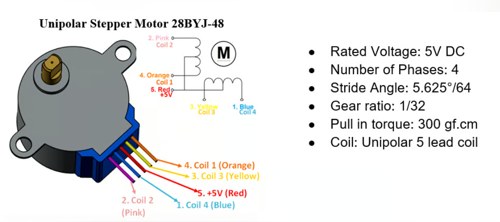
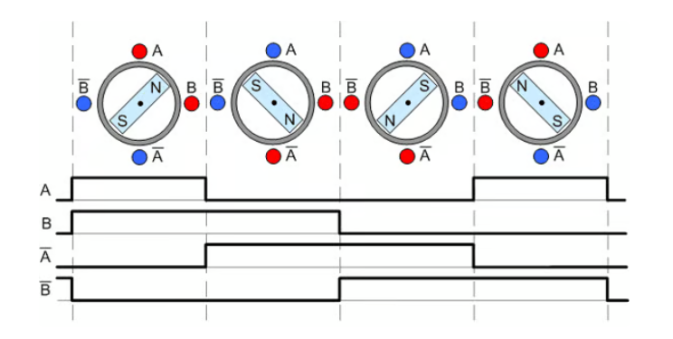
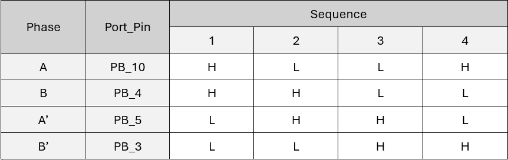
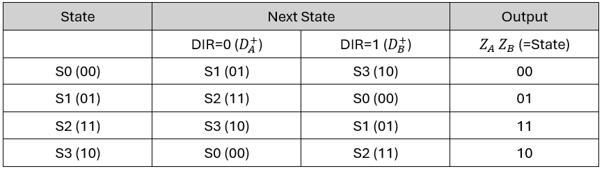
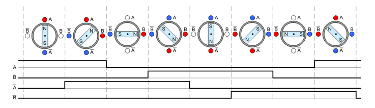
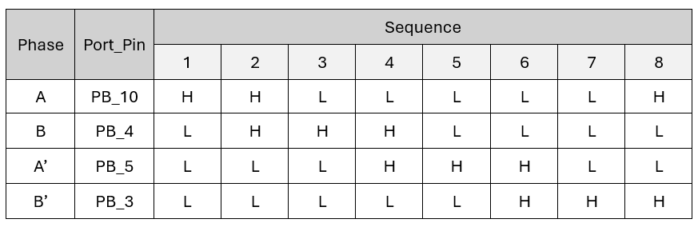
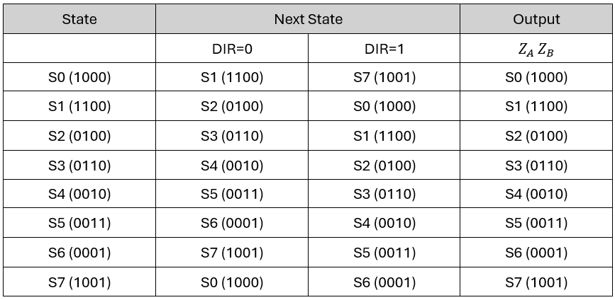
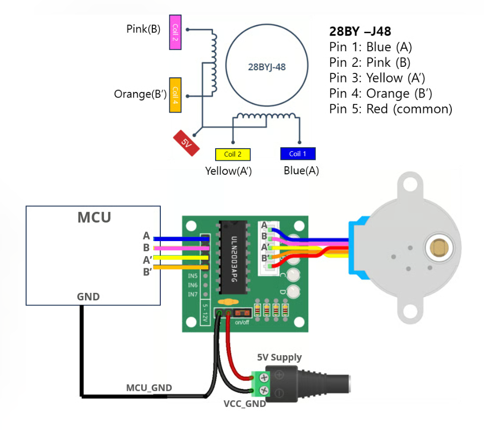
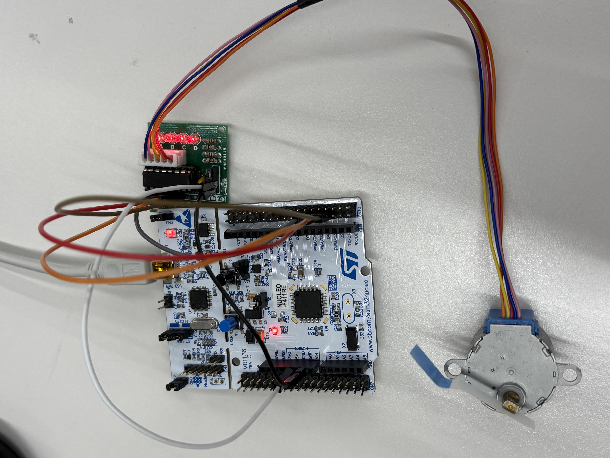

LAB: Stepper Motor

## LAB: Stepper Motor

**Date:** 2026-Oct-12

**Author:** Yu Chaeeun

**GitHub repository :** [GitHub Link](https://github.com/chaeeunyu/EC-STM32F4-22200476.git)

**Demo Video:** [demo video link](https://youtu.be/ZtiYtSjokvo)

​				 	    [demo video link - pause EXTI w/ button B1](https://youtu.be/55WukKRUPAA)

**PDF version:** [LAB_Stepper_Motor_22200476_YuChaeeun.pdf](LAB_Stepper_Motor_22200476_YuChaeeun.pdf)

## Introduction

In this lab, I drove a unipolar stepper motor (28BYJ-48) through a ULN2003 driver using only the digital GPIO outputs of the STM32F411RE. The coil excitation sequence was designed as a Moore-type Finite State Machine (FSM), where each state determines the output of the four coil inputs (A, B, A', B') and the next state is selected by the rotation direction.

I implemented both full-stepping (4 states) and half-stepping (8 states) as look-up tables, wrote a stepper library (`ecStepper2.h`, `ecStepper2.c`), and controlled the rotation speed by changing the delay between steps. I then measured the time per revolution at different speeds to find the minimum and maximum speed of the motor in each mode. In addition, I used the user button (PC13) with an external interrupt to pause and resume the motor.

#### Requirement

**Hardware**

* MCU
  
  * NUCLEO-F411RE
* Actuator/Sensor/Others:
  * Stepper Motor 28BYJ-48 (5V)
  * Motor Driver ULN2003

  * breadboard, jumper wires

**Software**

* VS Code, PlatformIO, CMSIS, EC_HAL library


***

## Problem : Stepper Motor Control with FSM

### Problem Description

For this lab, I used a stepper motor driver that requires a sequence of 4-input pulses as the input.

* **Driver:** **ULN2003 motor driver.**[ULN2003 spec sheet](https://www.electronicoscaldas.com/datasheet/ULN2003A-PCB.pdf)

* **Motor:** 28BYJ-48, Search for the spec sheet

  <figure align="center">
      
  </figure>


The tasks of this lab were:

1. Find out the number of steps required to rotate 1 revolution of the stepper motor with Full-steppping.
2. Then, rotate the stepper motor 5 revolutions with 1 rpm.
3. Repeat the above process in the opposite direction.
4. Increase and decrease the speed of the motor as fast as it can rotate to find the maximum and minimum speed of the motor.
5. Apply the half-stepping and repeat the above.

From the motor specification, the internal rotor needs 32 full steps (11.25° per step) for one turn, and the gear reduction ratio is about 1/64. Therefore, the output shaft needs 32 × 64 = 2048 steps per revolution in full-stepping. In half-stepping, each step moves half the angle of a full step, so 4096 steps per revolution are needed. Both values were confirmed by marking the output shaft and checking that it returned to the same position after one revolution.


### FSM design for Stepper Motor Sequence

I applied the finite state machine method to drive the stepper motor. Each state outputs a fixed combination of the four coil inputs (Moore machine), and the input of the FSM is the direction (`DIR`). The state transition and output of each state are stored in a table, so the code only needs to look up the next state instead of computing it with logic equations.

#### State Table for Full-Stepping

In full-stepping, two coils are always energized at the same time (AB → BA' → A'B' → B'A).

**Full-stepping sequence**

<figure align="center"> 
    
</figure>


<figure align="center"> 
    
    <figcaption><em>Full-stepping sequence table</em></figcaption>
</figure>


**State Table**: Moore FSM


<figure align="center">
    
    <figcaption><em>Full-stepping motor state table - moore</em></figcaption>
</figure>


#### State Table for Half-Stepping

**Half-stepping sequence**

<figure align="center">
    
</figure>

<figure align="center">
    
    <figcaption><em>Half-stepping motor sequence table</em></figcaption>
</figure>


* **State Table**: Moore FSM

<figure align="center">
    
    <figcaption><em>half-stepping motor state table - moore</em></figcaption>
</figure>


### Programming FSM

**Preparation**

* Library files: `ecStepper2.h`, `ecStepper2.c`, located in the directory `include\`
  
* Project: 

  ```
  EC\lab\
  ```

  - Environment: **`LAB_Stepper_Motor_22200476`**
  - Source File: **`LAB_Stepper_Motor_22200476.c`**

* A new environment was added to `platformio.ini` with `build_src_filter = +<lab/LAB_Stepper_Motor_22200476.c> +<include/*.c>`


#### Function Definitions

All functions below are implemented in `ecStepper2.c`.

**Global Variables and FSM Tables**

Private variables used inside the library and the FSM look-up tables for full-stepping and half-stepping.

```c
// Stepper Motor variable
static PinName_t stepperPins[4];
static volatile uint32_t _steps;
static volatile uint32_t _step_delay = 100;		
static const StateStepper_t *fsm;		// points at fsm_full or fsm_half (chosen in stepper_init)
static volatile uint32_t state = 0;		// current FSM state
volatile int pause_flag = 0;

// Output: A B A' B'
static const StateStepper_t fsm_Full[4] = {	
 	// {{next (Dir=0, Dir=1)}, {output (A, B, A', B')}}
	{{S1,S3},{HIGH,HIGH,LOW,LOW}},	// S0
	{{S2,S0},{LOW,HIGH,HIGH,LOW}},  // S1
	{{S3,S1},{LOW,LOW,HIGH,HIGH}},  // S2
	{{S0,S2},{HIGH,LOW,LOW,HIGH}},  // S3
};

static const StateStepper_t fsm_Half[8] = {  
	// {{next Dir=0, Dir=1}, {output A, B, A', B'}}
	{{S1,S7},{HIGH,LOW,LOW,LOW}},   // S0
	{{S2,S0},{HIGH,HIGH,LOW,LOW}},  // S1
	{{S3,S1},{LOW,HIGH,LOW,LOW}},   // S2
	{{S4,S2},{LOW,HIGH,HIGH,LOW}},  // S3
	{{S5,S3},{LOW,LOW,HIGH,LOW}},   // S4
	{{S6,S4},{LOW,LOW,HIGH,HIGH}},  // S5
	{{S7,S5},{LOW,LOW,LOW,HIGH}},   // S6
	{{S0,S6},{HIGH,LOW,LOW,HIGH}},  // S7
};
```

- `stepperPins[4]`: GPIO pins connected to A, B, A', B'
- `_steps`, `state`, `pause_flag`: shared between the main flow and the ISR, so they are declared `volatile`
- `fsm`: pointer to the selected table (`fsm_Full` or `fsm_Half`)
- `next[2]`: next state for `DIR = 0` and `DIR = 1`
- `out[4]`: output of the state in the order A, B, A', B'

------

#### stepper_init()

Selects the stepping mode (FSM table) and initializes the four stepper pins as fast digital outputs.

```c
void stepper_init(uint32_t mode, PinName_t *pinStepper){
	if (mode == HALF) 
		fsm = fsm_Half;
	else
		fsm = fsm_Full;

	//  GPIO Digital Out Initiation
	// For A, B, AN, BN

	for (int i=0; i<4; i++){
		stepperPins[i] = pinStepper[i];
		GPIO_init(stepperPins[i], OUTPUT);
	}
	FND_select_ospeed(stepperPins, FASTSPEED);
}
```

**Parameters**

- **mode**: stepping mode, `FULL` or `HALF`
- **pinStepper**: array of 4 pins in the order {A, B, A', B'}

**Example code**

```c
PinName_t pinStepper[4] = {PB_10, PB_4, PB_5, PB_3};
stepper_init(HALF, pinStepper);    // half-stepping mode
```

------

#### stepper_speed()

Converts the motor speed in [rpm] to the delay between steps in [msec].

```c
void stepper_speed (uint32_t speedRPM){      // rpm
		_step_delay = 60*1000/(HALFSTEP_PER_REV*speedRPM); 		//in [msec]	
		// [usec] can be used for a higher accuracy
		// But needs delay_us() 
}
```

**Parameters**

- **speedRPM**: target speed of the output shaft in [rpm] (integer, 1 – 14)

The step delay is derived from the units:
$$
\text{_step_delay}\ [\text{ms/step}] = \frac{60 \times 1000\ [\text{ms/min}]}{N_{step/rev}\ [\text{step/rev}] \times \text{speedRPM}\ [\text{rev/min}]}
$$
N_(step/rev) must match the stepping mode: `FULLSTEP_PER_REV` (2048) for full-stepping and `HALFSTEP_PER_REV` (4096) for half-stepping. The code above is the half-stepping version. Since all operands are integers, the decimal part of the result is truncated.

**Example code**

```c
stepper_speed(5);    // 5 rpm -> _step_delay = 60000/(4096*5) = 2 ms (half-stepping)
```

------

#### stepper_step()

Runs the motor for the given number of steps in the given direction, and waits while the motor is paused.

```c
void stepper_step(uint32_t steps, uint32_t direction){
	// Exit if stepper_init() not called 
	if (fsm == 0) return;
	_steps = steps;

	// run for step size: 
	for (uint32_t i = 0; i < _steps; i++){
		while(pause_flag == 1) {;}   // pause_flag: (resume=0, pause=1)
		// Update Present State
		state = fsm[state].next[direction];
		
		// Output of Present State
		stepper_out(state);
	
		// Delay for steppermotor speed
		delay_ms(_step_delay);
	}
	
}
```

**Parameters**

- **steps**: number of state transitions (steps) to run
- **direction**: rotation direction, `DIR_CW` or `DIR_CCW` (defined in `ecStepper2.h`). It is used as the index of `next[2]`.

The next state is selected by the present state and the direction (`fsm[state].next[direction]`), not by the loop counter. Because `state` is a static global variable, the motor continues from the position where the previous call ended. When `pause_flag` is 1, the loop waits at the `while` statement before updating the state, so neither `i` nor `state` changes and the last coil output is held.

**Example code**

```c
stepper_step(HALFSTEP_PER_REV*5, DIR_CW);    // 5 revolutions, CW (half-stepping)
stepper_step(STEP_PER_REV*5, DIR_CCW);       // 5 revolutions, CCW (full-stepping)
```

------

#### stepper_out()

Writes the output of the given state to the four stepper pins.

```c
void stepper_out(uint32_t state){
	
	// stepperPins[0]=A, stepperPins[1]=B, ...
	// out[0]=A, out[1]=B, ...

	// i want to give '1' to a certain pins(stepperPins[], A B A' B')
	for(uint32_t i=0; i<4; i++){
		GPIO_write(stepperPins[i], fsm[state].out[i]);
	}
}
```

**Parameters**

- **state**: present state (`S0` – `S3` for full-stepping, `S0` – `S7` for half-stepping)

Both HIGH and LOW values are written, so the coils that were on in the previous state are turned off.

**Example code**

```c
stepper_out(S1);    // full-stepping: A=LOW, B=HIGH, A'=HIGH, B'=LOW
```

------

#### stepper_stop()

Toggles the pause state of the motor (pause ↔ resume).

```c
void stepper_stop(void) {
    // _steps = 0;    
    
	// // All pins DigitalOut '0'
	// for(uint32_t i=0; i<4; i++){
	// 	GPIO_write(stepperPins[i], LOW);
	// }
	pause_flag ^= 1;
}
```

**Parameters**

- None

The original version (commented out) aborted the rotation by setting `_steps = 0` and turned off all coils. I changed it to toggle `pause_flag` with XOR so that pressing the button once pauses the motor and pressing it again resumes from the same step.

**Example code**

```c
void EXTI15_10_IRQHandler(void) {  
	if (is_pending_EXTI(BUTTON_PIN)) {
		stepper_stop();                     // pause or resume
		clear_pending_EXTI(BUTTON_PIN);
	}
}
```

> Note that this is a **blocking** stepper controller. While the stepper is running (or paused), the MCU stays inside `stepper_step()` and cannot process other polling commands. The button still works because the EXTI interrupt preempts the main flow.


#### Code

Source code: [github source code link](https://github.com/chaeeunyu/EC-STM32F4-22200476/blob/main/lab/LAB_Stepper_Motor_22200476.c)

The main source code `LAB_Stepper_Motor_22200476.c` is explained below.

**Global Definitions**

Pin assignment of the stepper motor and the user button.

```c
#include "stm32f411xe.h"
#include "ecGPIO2.h"
#include "ecRCC2.h"
#include "ecEXTI2.h"
#include "ecSysTick2.h"
#include "ecStepper2.h"

// ( A, B,  AN,  BN)
PinName_t pinStepper[4]    = {PB_10,PB_4,PB_5,PB_3};
#define BUTTON_PIN  PC_13
```

- **pinStepper**: GPIO pins connected to ULN2003 IN1–IN4 (A, B, A', B')
- **BUTTON_PIN**: user button B1 on the Nucleo board (`PC_13`)

------

#### setup()

Initializes the system clock, SysTick, the user button with EXTI, and the stepper motor.

```c
void setup(void){	
	RCC_PLL_init();                                 // System Clock = 84MHz
	SysTick_init();                                 // Systick init
	
	GPIO_init(BUTTON_PIN, INPUT);           		// GPIOC pin13 initialization
	GPIO_pupd(BUTTON_PIN, PULL_UP);
    EXTI_init(BUTTON_PIN, FALL, 10);           		// External Interrupt Setting

	stepper_init(FULL, pinStepper); 				// Stepper GPIO pin initialization
	stepper_speed(5, FULLSTEP_PER_REV);       		//  set stepper motor speed, 5 rpm
}
```

**Parameters**

- None

**Example code**

```c
// Full-stepping at 1 rpm
stepper_init(FULL, pinStepper);
stepper_speed(1, FULLSTEP_PER_REV);
```

The button is configured as a pull-up input and triggers EXTI on the falling edge (button pressed) with priority 10. The stepping mode and the speed were changed here for each experiment.

------

#### main()

Rotates the motor one revolution at a time repeatedly.

```c
int main(void) { 
	// Initialiization --------------------------------------------------------
	setup();
	uint32_t rev=1;
	uint32_t steps=FULLSTEP_PER_REV*rev;      //     <----------------------------- MODIFY(FULL/HALF)
	
	// Inifinite Loop ----------------------------------------------------------
	while(1){
		stepper_step(steps, DIR_CW);  // (Step : 2048, Direction : 0 or 1, Mode : FULL or HALF)
		// delay_ms(2000);
		// stepper_step(steps, DIR_CCW);  // (Step : 2048, Direction : 0 or 1, Mode : FULL or HALF)
		// delay_ms(2000);
	}
}
```

The number of steps per revolution must match the mode set in `setup()` (`HALFSTEP_PER_REV` for `HALF`, `STEP_PER_REV` for `FULL`). For the speed measurement, the motor rotated one revolution repeatedly in one direction so that the time per revolution could be measured from the video. The commented lines are used to rotate in the opposite direction.

------

#### EXTI15_10_IRQHandler()

Pauses or resumes the motor when the user button is pressed.

```c
void EXTI15_10_IRQHandler(void) {  
	if (is_pending_EXTI(BUTTON_PIN)) {
		stepper_stop();
		clear_pending_EXTI(BUTTON_PIN); // cleared by writing '1'
	}
}
```

**Parameters**

- None (called by hardware when EXTI line 13 is pending)

**Example code**

```c
EXTI_init(PC_13, FALL, 10);    // enables EXTI13 -> this handler is called on button press
```

The EXTI line is determined by the pin number regardless of the port, so PC13 uses EXTI13. Lines 10–15 share the same handler, `EXTI15_10_IRQHandler`. The ISR only toggles the flag and clears the pending bit, and the actual pause is handled inside `stepper_step()`.


#### Configuration

| Function     | Pins                | Configuration |
| ------------ | ------------------- | ------------- |
| A, B, A', B' | PB10, PB4, PB5, PB3 | DOUT, FAST    |
| Button (B1)  | PC_13               | DIN, PULL_UP  |


| Stepper Input | MCU pin | ULN2003 |
| ------------- | ------- | ------- |
| A             | PB_10   | IN1     |
| B             | PB_4    | IN2     |
| A'            | PB_5    | IN3     |
| B'            | PB_3    | IN4     |

The ULN2003 board is powered by +5V and GND, and the GND is shared with the Nucleo board.


#### Connection Diagram

The 28BYJ-48 coils require about 100 mA each, which is much larger than the current a GPIO pin can supply. Therefore, the MCU pins are connected to the inputs of the ULN2003 (Darlington transistor array), which switches the coil current from the 5V supply. The ULN2003 also has internal flyback diodes (COM pin) that absorb the back-EMF of the coils.

<figure align="center">
    
</figure>


#### Results

> <figure align="center">
>     
> </figure>
>
> I started the experiment at 5 rpm and then increased and decreased the speed to find the maximum and minimum speed at which the motor rotated normally. The time for one revolution of the output shaft was measured from the recorded video, using a mark on the shaft as the reference. The same procedure was repeated for full-stepping and half-stepping.
>
> Also, I applied EXTI so that the rotation of the motor is paused or resumed by clicking the button B1.
>
> | Mode          | Steps per rev | Min speed | Max speed |
> | ------------- | ------------- | --------- | --------- |
> | Full-stepping | 2048          | 1rpm      | 14 rpm    |
> | Half-stepping | 4096          | 1rpm      | 14 rpm    |
>
> The minimum and maximum speed that could be observed with normal operation were 1 rpm and 14 rpm in both modes.
>
> - **Minimum speed**: `speedRPM` is an integer (`uint32_t`), so 1 rpm is the smallest speed that can be set. (0 rpm causes division by zero.) To rotate slower than 1 rpm, the speed must be given with a finer unit or as a step delay directly.
> - **Maximum speed**: at 15 rpm, the step delay in half-stepping becomes `60000/(4096×15) = 0.98 → 0 ms`, and in full-stepping it becomes `60000/(2048×15) = 1.95 → 1 ms`, which is about twice the target speed. Above 14 rpm, the motor no longer rotated normally.
>
> **Time per revolution**
>
> Theoretically, the time for one revolution is
> $$
> T_{rev} = N_{step/rev} \times \text{_step_delay}
> $$
> At 5 rpm, one revolution should take exactly 60/5 = 12 s. In full-stepping, the theoretical step delay is `60000/(2048×5) = 5.86 ms`. However, the variable that receives the speed and the step delay are integer types, so the decimal part was truncated and 5 ms was used. As a result, one revolution took about 10 s (2048 × 5 ms = 10.24 s), which was shorter than the theoretical value. In other words, the motor rotated faster than the target speed (about 5.86 rpm).
>
> **Full-stepping vs. half-stepping**
>
> In half-stepping, the number of steps per revolution doubled (2048 → 4096), but the step delay was halved at the same time. Therefore, at the same rpm, the time for one revolution was the same in half-stepping and full-stepping (4 s at 14 rpm in both modes, and 58 s vs. about 56 s at 1 rpm). The small difference at 1 rpm comes from truncation: the truncated part of the delay (0.30 ms in full-stepping and 0.65 ms in half-stepping) is a different ratio of the step delay in each mode.

Video link : [demo video link](https://youtu.be/ZtiYtSjokvo)

​					[demo video link - pause EXTI w/ button B1](https://youtu.be/55WukKRUPAA)


#### Discussion

1. ##### Find out the trapezoid-shape velocity profile for a stepper motor. When is this profile necessary?

   > A trapezoidal velocity profile has three phases: an acceleration phase where the speed increases linearly, a constant velocity phase, and a deceleration phase where the speed decreases linearly until the motor stops. When speed is plotted against time, the shape is a trapezoid.
   >
   > This profile is necessary because a stepper motor is usually driven in open-loop. If a high step rate is applied suddenly from a standstill, the rotor cannot follow the rotating magnetic field because of its inertia and the inertia of the load. This causes missed steps or a stall, and since there is no feedback, the position error cannot be detected or corrected. The maximum step rate at which the motor can start from a standstill without losing steps (pull-in rate) is lower than the maximum step rate it can reach when it is accelerated gradually (pull-out rate). Therefore, by accelerating and decelerating gradually, the motor can reach a higher speed and stop at the exact position without overshoot or missed steps.
   >
   > The profile is especially needed for high-speed operation, for loads with large inertia, and for applications that require accurate positioning. In this lab, the maximum speed of 14 rpm was found by starting the motor directly at the target speed, so a higher speed might be achievable with an acceleration profile. In the code, this can be implemented by gradually decreasing _step_delay at the beginning of the motion and gradually increasing it before the end of the motion.
   
2. ##### How would you change the code more efficiently for micro-stepping control? You don’t have to code this but need to explain your strategy.

   > In full-stepping and half-stepping, each coil is only turned on or off. In micro-stepping, the currents of the two coils are divided in a sine/cosine ratio so that the rotor can stop at intermediate angles between full steps. My strategy is as follows.
   >
   > First, I would keep the FSM look-up table structure, but change the output of each state from HIGH/LOW to a duty value taken from a sine/cosine look-up table. Second, instead of GPIO digital outputs, I would use PWM outputs from a timer (TIMx) to control the average current of each coil according to the duty value. Third, the next state can be generalized as (state + 1) mod N for one direction and (state - 1 + N) mod N for the other direction, so the next[] field is no longer needed and the resolution can be changed simply by changing the number of states N. Fourth, the stepping mode and the number of steps per revolution would be stored in stepper_init(), so that stepper_speed() and the step calculation always use the correct value instead of a hard-coded constant. Finally, since the step delay becomes much shorter in micro-stepping, the delay should be calculated in microseconds, and the stepping should be done in a timer interrupt (non-blocking) instead of delay_ms() so that the MCU can handle other tasks while the motor is running.
   >
   > However, the ULN2003 is a simple on/off switch without current control, so with this driver, micro-stepping can only be approximated by PWM. For accurate micro-stepping, a driver with current control is more suitable.
   
3. ##### There are other types of Stepper Motor Drivers that are simple to use, such as you only give one pulse signal and direction, instead of giving 4 pulse signals. Such examples are A4988, DRV 8834, and TB6600 drivers. Compare these motor drivers with ULN2003 in terms of operating method.

   > The ULN2003 is a Darlington transistor array that works as a low-side switch for each coil. It only amplifies the current of the input signal and does not generate the stepping sequence. Therefore, the MCU must generate the four coil signals and the stepping sequence (FSM) by itself, as done in this lab. It is used for unipolar motors, and the coil current is not controlled; the motor is driven only by the supply voltage.
   >
   > On the other hand, the A4988, DRV8834, and TB6600 drivers contain a translator that generates the stepping sequence internally and H-bridges that drive the coils. The MCU only needs to give a STEP pulse and a DIR signal: one pulse moves the motor by one step, and the DIR pin decides the rotation direction. These drivers are used for bipolar motors. They also have chopper (PWM) current control, which limits the coil current to a set value. Because of this, a higher supply voltage can be used so that the coil current rises faster, which allows higher speeds. Micro-stepping can also be selected simply by setting the MS pins.
   >
   > In summary, the ULN2003 needs four MCU pins and the MCU has to handle the sequence and timing of every step, while the pulse/direction drivers need only two pins, reduce the load on the MCU, and support higher speed and micro-stepping. Also, since only a pulse train is needed, the step signal can easily be generated by a timer PWM output, which makes non-blocking control simpler.


### Troubleshooting

**1. Wrong next-state update in `stepper_step()`**

- **Problem**: The first version used `state = fsm[i].next[direction];`.
- **Cause**: `i` is the loop counter, which goes up to the number of steps. When `i ≥ 4` (full-stepping), it reads outside the table (out-of-bounds access), and the direction is also wrong. In an FSM, the next state depends on the present state and the input, not on how many times the loop has run.
- **Solution**: Changed it to `state = fsm[state].next[direction];`. I also understood that the next-state logic equations (e.g. $D_a^+ = DIR \oplus D_b$) are not needed in software, because their results are already written in the state table (look-up table).

**2. Compile error in `stepper_out()`: "expression must have struct or union type"**

- **Problem**: `fsm.out[0] = stepperPins[0];` caused a compile error.
- **Cause**: `fsm` is a pointer (`const StateStepper_t *`), not a struct, so the `.` operator cannot be used directly. The row of the table must be selected first. Also, the assignment direction was reversed, and writing to a variable does not change the voltage of the pin.
- **Solution**: Selected the row with the present state and wrote the output to each pin with `GPIO_write(stepperPins[i], fsm[state].out[i]);` for all four pins.

**3. Pause and resume with the user button**

- **Problem**: I wanted the motor to stop when the button is pressed and to continue when it is pressed again, but the original `stepper_stop()` sets `_steps = 0`, which ends the loop (abort) and loses the remaining steps.
- Cause / Trials:
  - Putting `if(pause_flag == 0){ ... }` inside the loop: the step update was skipped during pause, but `i++` still ran, so the loop ended quickly.
  - Putting `if(pause_flag == 0)` outside the loop: the flag was checked only once when the function started, so the motor could not be paused during rotation.
- **Solution**: Added `while(pause_flag == 1) {;}` at the beginning of each loop iteration. During pause, neither `i` nor `state` changes, and the last coil output is held (holding torque). `stepper_stop()` was changed to toggle the flag (`pause_flag ^= 1`). Since `pause_flag` is changed in the ISR and read in the loop, it was declared `volatile`; otherwise the compiler may read it only once and the motor would never resume.