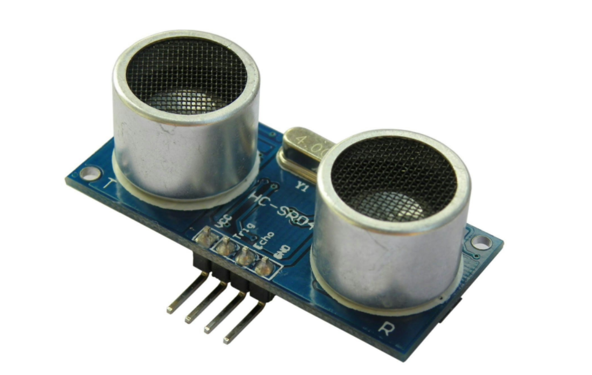
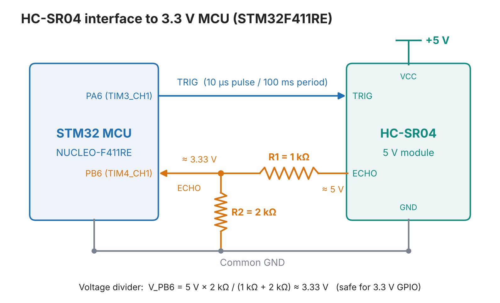
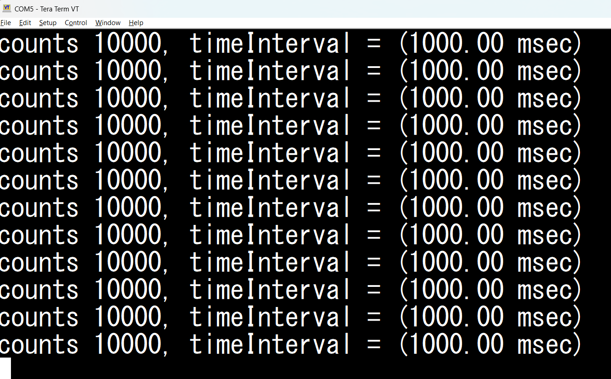
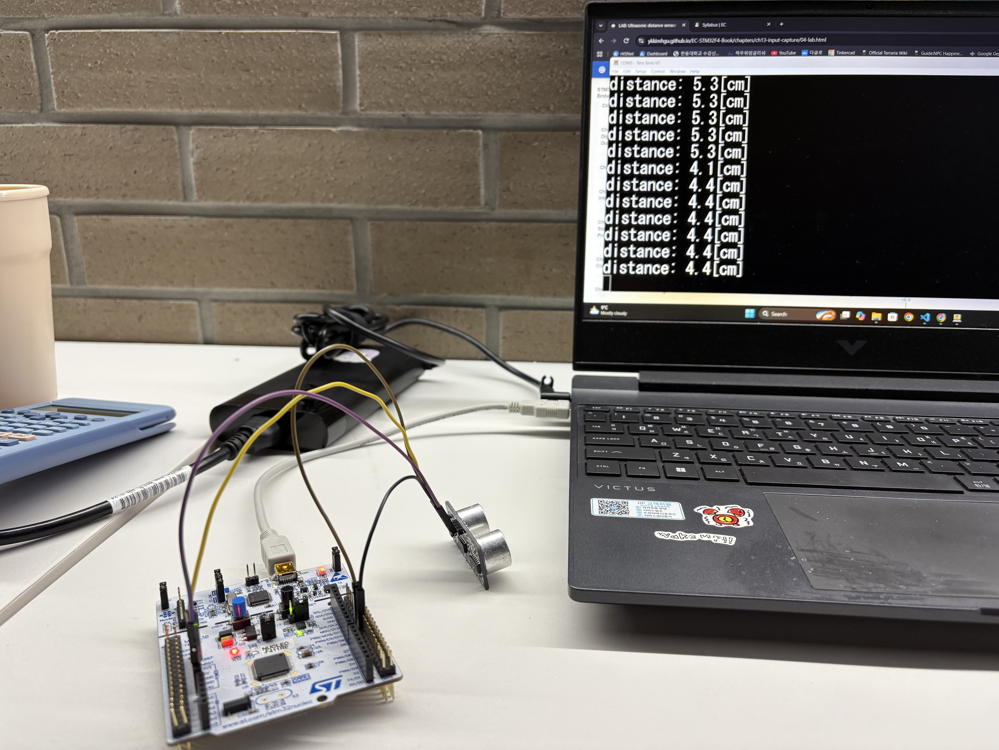
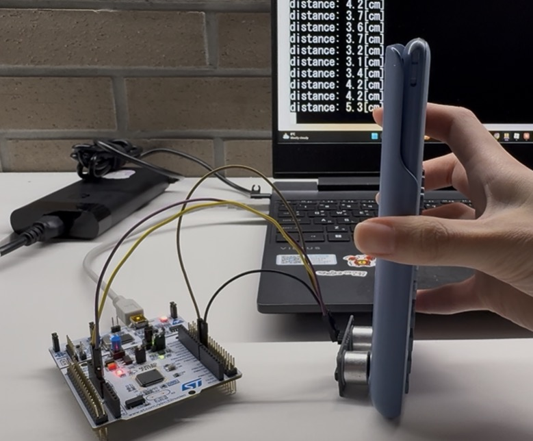
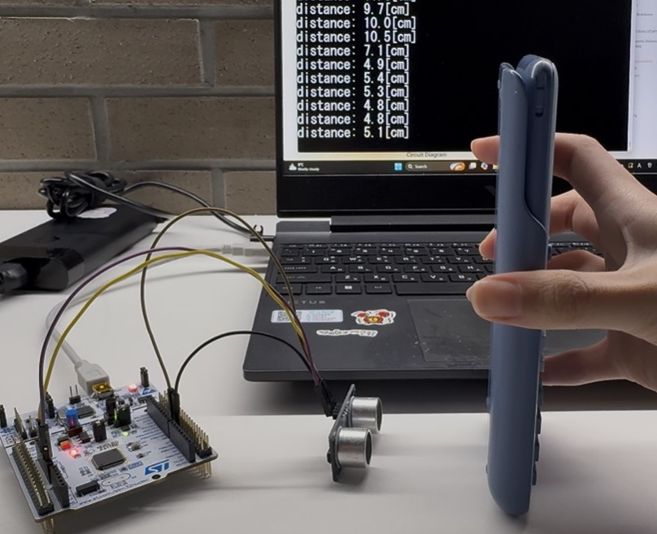
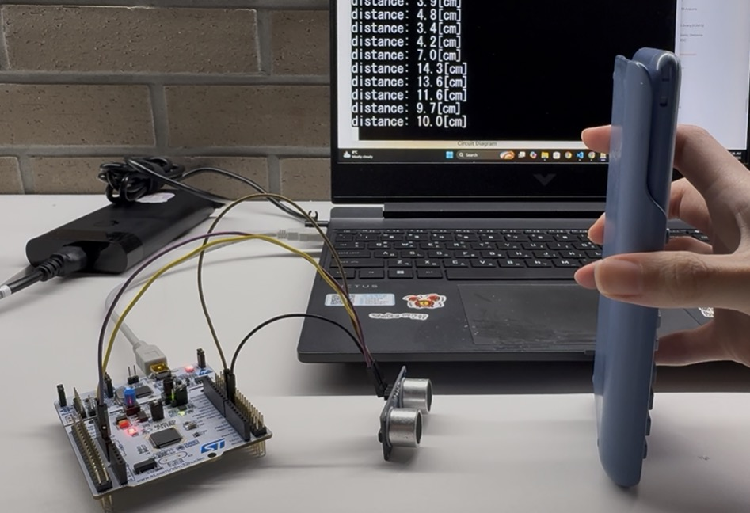

# LAB: Input Capture - Ultrasonic

**Date:** 2026-Nov-12

**Author:** Yu Chaeeun

**Github:** [repository link](https://github.com/chaeeunyu/EC-STM32F4-22200476.git)

**Demo Video:** [demo video link](https://youtu.be/5d8V1BdkA3c)


## Introduction

In this lab, the distance to an object is measured with an HC-SR04 ultrasonic distance sensor. A timer PWM output generates the trigger pulse for the sensor, and the timer input capture mode measures the pulse width of the echo signal. The echo pulse width is converted to a distance in [cm] and displayed on the Tera-Term serial monitor.


### Requirement

#### Hardware

* MCU
  - NUCLEO-F411RE
* Actuator/Sensor/Others:
  - HC-SR04
  - Breadboard
  - Resistors: 1 kΩ, 2 kΩ (voltage divider for ECHO)
  - Jumper wires

#### Software

* VS Code, CMSIS, EC_HAL library


***

## Problem: Ultrasonic Distance Sensor (HC-SR04)

The HC-SR04 ultrasonic distance sensor provides 2 cm to 400 cm of non-contact measurement with a ranging accuracy that can reach up to 3 mm. Each HC-SR04 module includes an ultrasonic transmitter, a receiver and a control circuit.



**The HC-SR04 Ultrasonic Range Sensor Features:**

* Input Voltage: 5V
* Current Draw: 20mA (Max)
* Digital Output: 5V
* Digital Output: 0V (Low)
* Sensing Angle: 30° Cone
* Angle of Effect: 15° Cone
* Ultrasonic Frequency: 40kHz
* Range: 2cm - 400cm

**Operating principle**

1. A HIGH pulse of at least 10 µs is applied to the TRIG pin.
2. The sensor transmits a 40 kHz ultrasonic burst.
3. The ECHO pin stays HIGH until the reflected wave returns. The ECHO HIGH pulse width is the round-trip time of the sound.

$$
d\,[\text{cm}] = \frac{t_{echo}\,[\mu s] \times 340\,[\text{m/s}] \times 100 \times 10^{-6}}{2} = t_{echo}\,[\mu s] \times 0.017
$$

For example, an echo pulse of 588 µs corresponds to about 10 cm (1 cm ≈ 58.8 µs).


### Procedure

1. A new project named `LAB_TIMER_ICAP` was created, with the source file `LAB_TIMER_ICAP_22200476.c`.
2. The updated library in `\include\` was added to the project. `ecSTM32F4v2.h` includes:

```c
// EC course Library
#include "ecPinNames.h"
#include "ecRCC2.h"
#include "ecGPIO2.h"
#include "ecEXTI2.h"
#include "ecSysTick2.h"
#include "ecUART2.h"
#include "ecTIM2.h"
#include "ecPWM2.h"
#include "ecCAP2.h"
```

3. The HC-SR04 was connected to the MCU pins.

- PA6 - TRIG
- PB6 - ECHO (through a 1 kΩ / 2 kΩ voltage divider)
- VCC (5 V) and GND, with a common ground between the MCU and the sensor

### Distance Measurement

* The program

  - generates a trigger pulse as PWM to the sensor,
  - receives echo pulses from the ultrasonic sensor,
  - measures the distance by calculating the pulse width of the echo pulse,
  - displays the measured distance in [cm] on the Tera-Term serial monitor for (a) 10 mm, (b) 50 mm, (c) 100 mm.
  
  Note that 10 mm is below the minimum range of the sensor (2 cm), so the result for (a) is treated as an out-of-range observation.

### Configuration

| System Clock | PWM                                                          | Input Capture                                                |
| ------------ | ------------------------------------------------------------ | ------------------------------------------------------------ |
| PLL (84MHz)  | PA6 (TIM3\_CH1)                                              | PB6 (TIM4\_CH1)                                              |
|              | <p>AF, Push-Pull,<br>No Pull-up Pull-down, Fast</p>          | AF, No Pull-up Pull-down                                     |
|              | <p>PWM period: 100 msec<br/>pulse width: 10 usec<br/>Counter tick: 10 usec (PSC = 839, ARR = 9999)</p> | <p>Counter Clock : 0.1MHz (10us)<br>CH1 -> TI1 -> IC1 (rising edge)<br>CH1 ->TI1 -> IC2 (falling edge)</p> |

- A 100 ms trigger period is longer than the maximum echo time (about 38 ms when no object is detected), so a new trigger is never sent before the previous echo ends.
- With a 10 µs capture tick, the distance resolution is 10 µs × 0.017 cm/µs = **0.17 cm**.
- With a 16-bit counter, TIM4 wraps every 65536 × 10 µs ≈ 655 ms, which is much longer than the echo pulse at 400 cm (about 23.5 ms). The overflow count is still included in the calculation for robustness.

### Circuit Diagram

> You need to include the circuit diagram



The ECHO output of the HC-SR04 is 5 V, while the STM32 GPIO is 3.3 V logic. A voltage divider lowers the ECHO voltage to a safe level:
$$
V_{PB6} = 5\,\text{V} \times \frac{2\,\text{k}\Omega}{1\,\text{k}\Omega + 2\,\text{k}\Omega} \approx 3.33\,\text{V}
$$
The input impedance of the GPIO pin is much larger than 2 kΩ, so the loading effect on the divider is negligible.


### Discussion

1. **There can be an over-capture case, when a new capture interrupt occurs before reading the CCR value. When does it occur and how can you calculate the time span accurately between two captures?**

> **When it occurs:** Over-capture occurs when a new edge is captured while the previous capture flag (CCxIF) is still set, i.e., before the CPU has read the CCRx register. The hardware then sets the over-capture flag (CCxOF in TIMx_SR) and overwrites CCRx with the new value, so the previous timestamp is lost. This happens when
>
> - the input edges arrive faster than the ISR can serve them (very high input frequency),
> - the ISR is delayed by a higher-priority interrupt or by a long ISR,
> - interrupts are disabled for a long time in the main code.
>
> **Difference from counter overflow:** Counter overflow (UIF) means that the counter wrapped from ARR to 0 between two captures. It does not lose any capture. It only requires counting the number of wraps. Over-capture means that a capture itself is lost.
>
> **Accurate time span:** When no capture is lost, the time span between two captures is
> $$
> \Delta t = \left[(CCR_{curr} - CCR_{prev}) + N_{ovf} \times (ARR+1)\right] \times t_{tick}
> $$
> where N_ovf is the number of overflows between the two captures. In this lab, N_ovf is reset at the rising edge (start of the echo pulse) and the width is calculated at the falling edge. Because the variables are unsigned 32-bit integers, the subtraction gives the correct result even when CCR_(curr) < CCR__(prev) (modulo-2^32 arithmetic).
>
> To keep the result accurate:
>
> - Read CCRx as early as possible in the ISR. Reading CCRx also clears CCxIF.
> - Check CCxOF. If it is set, at least one capture was lost and the measured span covers an unknown number of periods. The sample should be discarded and CCxOF cleared. The original interval can be recovered only if the signal is known to be periodic and the number of lost captures is known.
> - If UIF and CCxIF are set at the same time in one ISR call, the overflow may have happened just before or just after the capture. It can be decided by checking the captured value: a value near 0 means the capture came after the overflow, and a value near ARR means it came before.
> - Using two channels (IC1 for the rising edge, IC2 for the falling edge) stores each edge in a separate CCR register, so one edge does not overwrite the other.
>
> In this lab the echo pulse is at most about 38 ms and the trigger period is 100 ms, while the ISR takes only a few µs, so over-capture is very unlikely.


2. **In the tutorial, what is the accuracy when measuring the period of 1Hz square wave? Show your result.**

> In the tutorial (`TU_TIM_ICAP_example1`), a 1 Hz square wave (period 1000 ms) was generated on PA6 (TIM3_CH1) and its period was measured on PB6 (TIM4_CH1) with a capture tick of 100 µs.
>
> - Expected counts: 1000 ms / 100 µs = 10000 ticks
> - Quantization error: ±1 tick = ±100 µs
> - Resolution (relative): 100 µs / 1 s = ±0.01 %
>
> 
>
> The measured period was 1000 ms, which agrees with the expected 1000 ms within the ±1 tick resolution. Both TIM3 (signal generation) and TIM4 (measurement) are driven by the same 84 MHz system clock, so an error in the clock frequency cancels out in this test. To check the absolute accuracy, an external reference such as an oscilloscope or a function generator is needed.


### Code

[Repository link](https://github.com/chaeeunyu/EC-STM32F4-22200476.git)

#### `TIM_period_tick()` (added to ecTIM2.c)

Sets the counter tick and the period of a timer at the same time. The existing `TIM_period_ms()` (fixed 100 µs tick) and `TIM_period_us()` (fixed 1 µs tick) cannot produce a 10 µs pulse within a 100 ms period on a 16-bit timer, so a generalized function was added.

```c
void TIM_period_tick(TIM_TypeDef* TIMx, uint32_t tick_us, uint32_t period_us){
    // initialize
	uint32_t PSCval = 0;
	uint32_t ARRval = 0;

    // 1. PSC : number of SYSCLK clocks per tick
    PSCval = (EC_SYSCLK / 1000000UL) * tick_us;   // clocks per tick
    TIMx->PSC = PSCval - 1;

    // 2. ARR : number of ticks per period
    ARRval = period_us / tick_us;                 // ticks per period
    TIMx->ARR = ARRval - 1;
}
```

**Code structure**

1. PSC: 84 MHz gives 84 clocks per µs, so PSC + 1 = 84 × `tick_us`.
2. ARR: the number of ticks in one period, ARR + 1 = `period_us` / `tick_us`.

**Parameters**

| Parameter   | Type           | Description                      |
| ----------- | -------------- | -------------------------------- |
| `TIMx`      | `TIM_TypeDef*` | Timer to configure (e.g. `TIM3`) |
| `tick_us`   | `uint32_t`     | Counter tick [µs]                |
| `period_us` | `uint32_t`     | Timer period [µs]                |
| return      | void           | -                                |

**Constraints:** For a 16-bit timer, both PSC + 1 and ARR + 1 must be within 1 ~ 65536. A pulse width can only be set in integer multiples of `tick_us`. With `tick_us` = 1, ARR + 1 = 100000 exceeds 16 bits. With `tick_us` = 100, a 10 µs pulse becomes 0.1 tick (CCR = 0). Therefore 10 µs was chosen.

**Example**

```c
PWM_init(PA_6, 100);                  // GPIO AF and PWM mode (default tick 100 us)
TIM_period_tick(TIM3, 10, 100000);    // tick 10 us, period 100 ms -> PSC = 839, ARR = 9999
TIM3->EGR |= TIM_EGR_UG;              // apply the new PSC immediately (PSC is preloaded)
```


#### `main()`: distance calculation and output

**Function and purpose.** Converts the latest echo pulse width to a distance and prints it to Tera-Term periodically. The calculation is done in `main()` instead of in the ISR to keep the ISR short.

```c
int main(void){
    setup();
    printf("\n\n---------------------------\r\n");
    printf("mcu initialized\r\n");

    while(1){
        distance = timeInterval * SOUND_HALF_CM_PER_US;     // [usec] * [cm/usec] = [cm]
        printf("distance: %.1f[cm]\r\n", distance);
        led_toggle(LED_PIN);
        delay_ms(2000);
    }
}
```

**Code structure.** In the loop, the latest `timeInterval` (updated by the ISR) is multiplied by 0.017 cm/µs, printed, and the LED is toggled as an alive indicator. The output uses one decimal place because the distance resolution is 0.17 cm.

**Example output format**

```
distance: 5.1[cm]
```


#### `TIM4_IRQHandler()`: echo pulse width measurement

**Function and purpose.** Handles the TIM4 interrupt. It counts counter overflows, stores the rising-edge timestamp, and calculates the echo pulse width at the falling edge.

```c
void TIM4_IRQHandler(void){
    // Counter overflow
    if(is_UIF(TIM4)){
        ovf_cnt++;
        clear_UIF(TIM4);
    }

    // Rising edge of ECHO captured on IC1 : start of the pulse
    if(is_CCIF(TIM4, IC_1)){
        cap_prev = ICAP_read(ICAP_PIN, IC_1);
        ovf_cnt  = 0;                           // count overflows from the start of the pulse
        clear_CCIF(TIM4, IC_1);
    }

    // Falling edge of ECHO captured on IC2 : end of the pulse
    if(is_CCIF(TIM4, IC_2)){
        cap_curr = ICAP_read(ICAP_PIN, IC_2);

        // Ticks between the two edges, then scaled to usec
        counts = (cap_curr - cap_prev) + (ovf_cnt * timer_arr);
        timeInterval = counts * uTick;

        clear_CCIF(TIM4, IC_2);
    }
}
```

**Code structure**

1. **UIF**: increase `ovf_cnt` on every counter wrap.
2. **CC1IF (rising edge)**: read CCR1 into `cap_prev` and reset `ovf_cnt`. Resetting at the rising edge ensures that overflows during the LOW period are not added to the next pulse width.
3. **CC2IF (falling edge)**: read CCR2, compute `counts = (cap_curr − cap_prev) + ovf_cnt × (ARR+1)`, and convert it to µs.

| Helper                                        | Parameters             | Return                            |
| --------------------------------------------- | ---------------------- | --------------------------------- |
| `is_UIF(TIMx)` / `clear_UIF(TIMx)`            | timer                  | UIF flag (non-zero if set) / none |
| `is_CCIF(TIMx, ICn)` /`clear_CCIF(TIMx, ICn)` | timer, capture channel | CCxIF flag / none                 |
| `CAP_read(pin, ICn)`                          | pin, capture channel   | captured counter value (CCRn)     |

**Example.** For an object at 5 cm: echo ≈ 294 µs → `counts` ≈ 29 ticks → `timeInterval` = 290 µs → distance = 290 × 0.017 ≈ 4.9 cm.


### Results

Experiment images and results

> 
>
> The distance was then measured with the HC-SR04 for the three test distances.
>
> | Target distance | Measured distance [cm] | Note                                                    |
> | --------------- | ---------------------- | ------------------------------------------------------- |
> | (a) 10mm        | 5.3[cm]                | Below the minimum range (2cm): out-of-range observation |
> | (b) 50mm        | 5.1[cm]                | -                                                       |
> | (c) 100mm       | 10.0[cm]               | -                                                       |
>
> **(a) 10 mm**
>
> 
>
> **(b) 50 mm**
>
> 
>
> **(c) 100 mm**
>
> 
>
> For (b) 50 mm and (c) 100 mm, the measured distances were 5.1 cm and 10.0 cm, which agree with the actual distances within 1 mm. This error is comparable to the measurement resolution (0.17 cm, from the 10 µs capture tick) and the specified accuracy of the sensor (3 mm), so the distance calculation works correctly.
>
> For (a) 10 mm, the sensor displayed about 5.3 cm, which does not represent the actual distance. 10 mm is below the minimum range of the HC-SR04 (2 cm). After a trigger, the sensor transmits a 40 kHz burst of 8 cycles (about 200 µs, equivalent to about 3.4 cm). An echo that returns during this burst, or while the transducer is still ringing, cannot be detected. The receiver may then respond to a later multiple reflection between the sensor and the object instead, so measurements inside this blind zone are unreliable.

Add [demo video link](https://youtu.be/5d8V1BdkA3c)


## Troubleshooting

**1. No TRIG pulse with `PWM_pulsewidth_us(PA_6, 10)`**

`PWM_init(PA_6, 100)` uses `TIM_init_ms()` for a 100 ms period on the 16-bit TIM3, which sets a 100 µs tick (PSC = 8399, ARR = 999). A 10 µs pulse is only 0.1 tick, so the calculated counts become 0 and CCR1 = 0. To output the pulse, the tick must satisfy two conditions at the same time:

- 10 µs must be an integer number of ticks → tick ≤ 10 µs
- 100 ms must fit in a 16-bit ARR → tick ≥ 100 ms / 65536 ≈ 1.53 µs

A 10 µs tick was selected, and `TIM_period_tick()` was added to set it.

**2. Integer division when generalizing the ARR calculation**

The existing code calculates `ARR = (f_cnt / 1000000) * usec`. This works only for f_cnt = 1 MHz. For f_cnt = 100 kHz (10 µs tick), `100000 / 1000000` becomes 0 in integer division, and `ARR = 0 - 1` wraps around to 0xFFFF on the 16-bit register, which gives a period of about 655 ms without any compiler warning. Multiplying first (`f_cnt * usec / 1000000`) would overflow `uint32_t` (10¹⁰), so the ARR was calculated directly as `period_us / tick_us`.

**3. PSC change not applied immediately**

PSC is a preload register and is updated only at the next update event. Since the counter is already running after `PWM_init()`, `TIM3->EGR |= TIM_EGR_UG` was added after `TIM_period_tick()`.

**4. Wrong pulse width caused by the overflow counter**

In the tutorial code, `ovf_cnt` was reset only at the falling edge. If the counter overflowed during the LOW period of the signal, the overflow was added to the next pulse width, which produced occasional large values. The reset was moved to the rising edge, so only the overflows inside the pulse are counted.