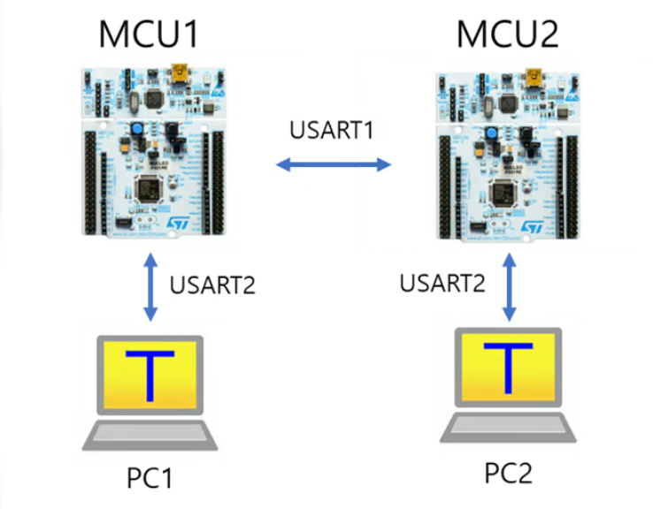
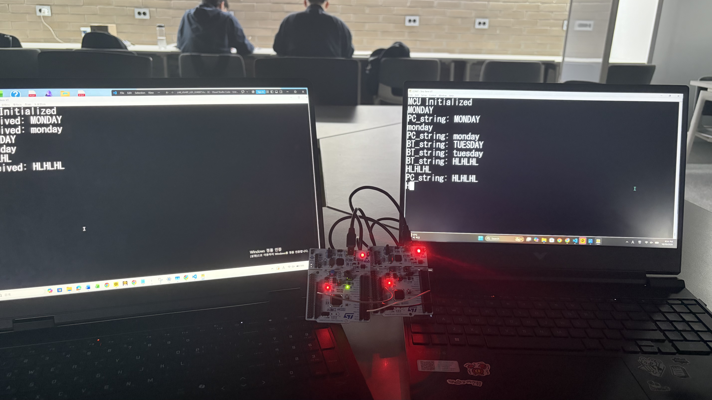
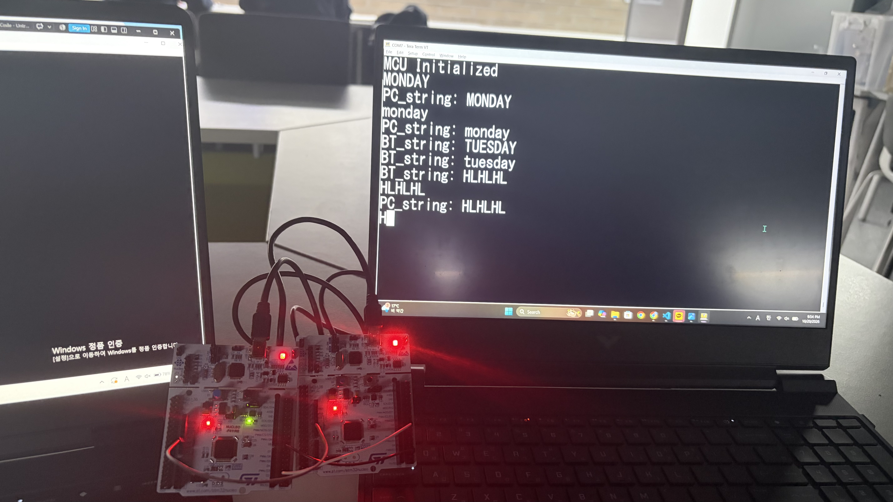
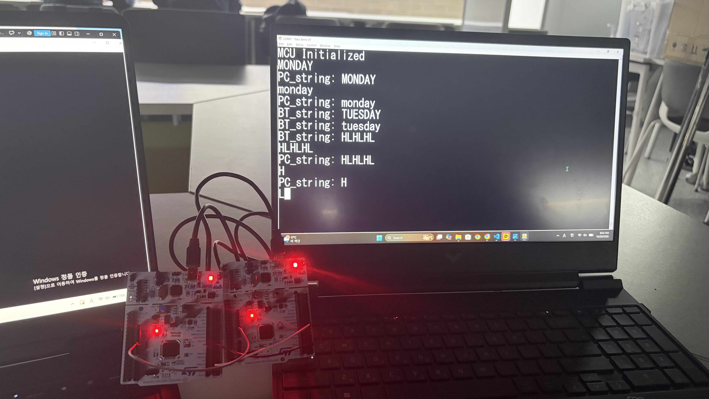
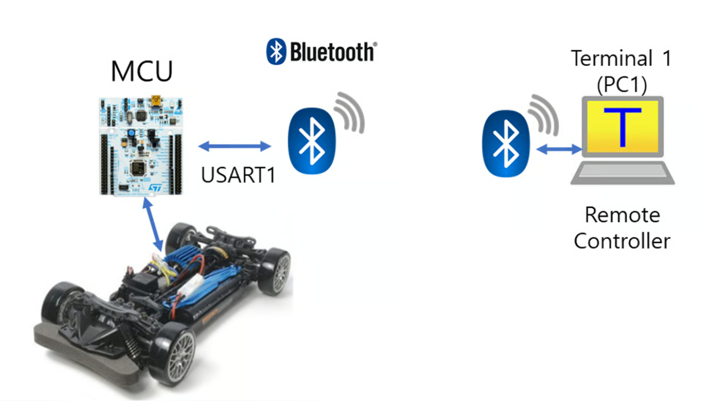
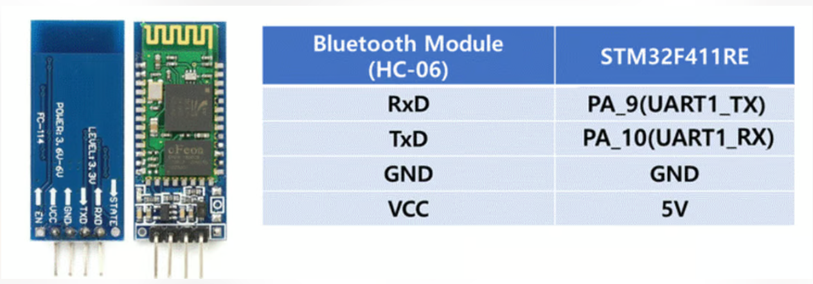
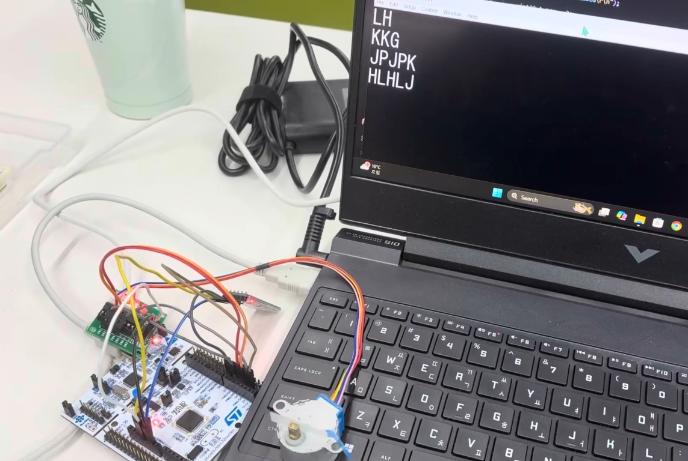
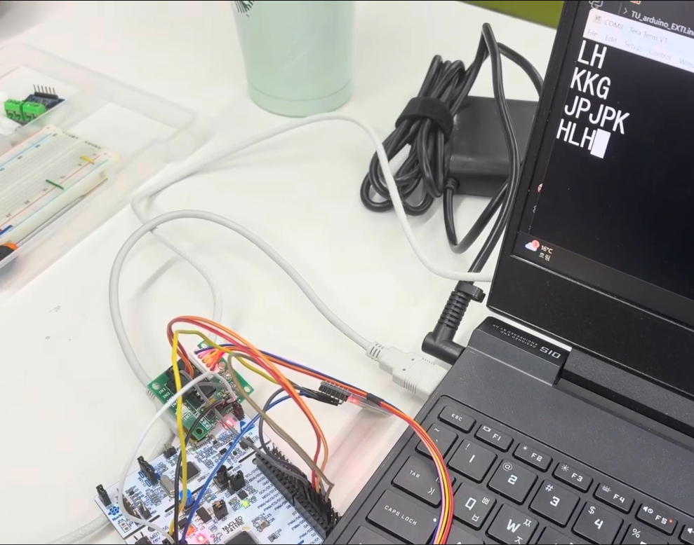
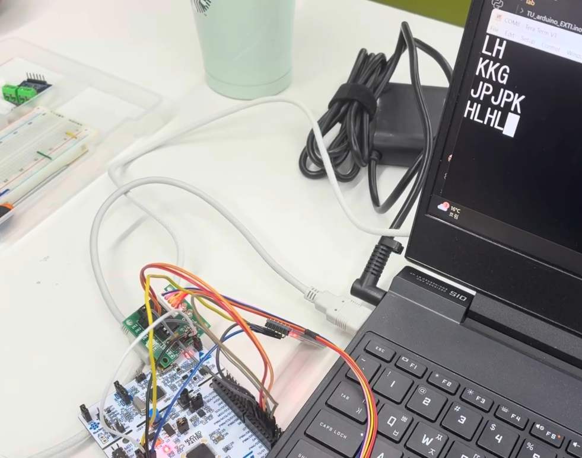

# LAB: USART - Bluetooth

**Date:** 2026-10-20

**Author/Partner:** Yu Chaeeun / Ji Ye-eun (problem 1)

**Github:** [repository link](https://github.com/chaeeunyu/EC-STM32F4-22200476.git)

**Demo Video:** [Problem1_video](https://youtu.be/DS2dkUAWACA)

​				 		[Problem 2 video](https://youtu.be/0kP_j8nmzCQ)

**PDF version:** [LAB_USART_22200476.pdf](LAB_USART_22200476.pdf)

## Introduction

In this lab, the USART (Universal Synchronous Asynchronous Receiver Transmitter) peripheral of the STM32F411 MCU was configured and used for serial communication. First, a general-purpose USART library (`ecUART2.c/h`) was completed. Then, wired serial communication between a PC and an MCU, and between two MCUs, was implemented. Finally, the wired link was replaced with a Bluetooth module (HC-06) to control a stepper motor wirelessly.

* **Mission 1**: Control LED(LD2) of other MCU using wired serial communication
* **Mission 2**: Control a stepper motor with wireless Bluetooth communication

Submitted files

- LAB Report (*.md & *.pdf)
- Zipped source files (`LAB_USART_LED_22200476.c`, `LAB_USART_Bluetooth_22200476.c`, `ecUART2.c/h`, `ecGPIO2.c/h`, `ecRCC2.c/h`, `ecSysTick2.c/h`, `ecEXTI2.c/h`, `ecStepper2.c/h`, `ecPinNames.c/h`, `ecSTM32F4v2.h`)

### Requirement

#### Hardware

* MCU
  - NUCLEO-F411RE (x2 for Problem 1)
* Actuator/Sensor/Others:
  - Stepper motor (28BYJ-48) and motor driver (ULN2003)
  - Bluetooth Module (HC-06)
  - Jumper wires

#### Software

- VS Code (PlatformIO), CMSIS, EC_HAL library
- Tera Term (serial terminal)


## Problem 0: USART library

The provided files `ecUART2_student.c` and `ecUART2_student.h` were renamed to `ecUART2.c` and `ecUART2.h`, and the header file was placed in `EC\include\`. `ecSTM32F4v2.h` was updated to include `ecUART2.h`.

The functions in the EXERCISE section were implemented as follows. All USARTs are configured as 8-N-1 (8 data bits, no parity, 1 stop bit) with oversampling by 16.


### USART_init()

Initializes a USART with the given TX/RX pins and baud rate, and enables its RX interrupt.

```c
void USART_init(USART_TypeDef* USARTx, PinName_t pin_GPIO_TX, PinName_t pin_GPIO_RX, uint32_t baud){
//1. GPIO Pin for TX and RX
	USART_pins(USARTx, pin_GPIO_TX, pin_GPIO_RX);

//2. USARTx (x=2,1,6) configuration
	USART_clock_enable(USARTx);

	// Disable USARTx.
	USARTx->CR1 &= ~USART_CR1_UE; 	// USART disable

	// No Parity / 8-bit word length / Oversampling x16 / Stop bit =1
	USARTx->CR1 &= ~USART_CR1_PCE;
	USARTx->CR1 &= ~USART_CR1_M;
	USARTx->CR1 &= ~USART_CR1_OVER8;
	USARTx->CR2 &= ~USART_CR2_STOP;

	// Set Baudrate using APB frequency
	USART_baud(USARTx, baud);

	// Enable TX, RX, and USARTx
	USARTx->CR1 |= (USART_CR1_RE | USART_CR1_TE);   	// Transmitter and Receiver enable
	USARTx->CR1 |= USART_CR1_UE; 						// USART enable

// 3. RX interrupt (data ready to be read)
	// Enable RXNE interrupt
	USARTx->CR1 |= USART_CR1_RXNEIE;
	// USART_IRQn
	uint32_t USART_IRQ = USART2_IRQn;	// USART2
	if(USARTx == USART1){				// USART1
		USART_IRQ = USART1_IRQn;
	}
	if(USARTx == USART6){				// USART6
		USART_IRQ = USART6_IRQn;
	}

	NVIC_SetPriority(USART_IRQ, 1);
	NVIC_EnableIRQ(USART_IRQ);
}
```

**Parameters**

- `USARTx` : `USART1`, `USART2`, or `USART6`
- `pin_GPIO_TX` : TX pin (e.g., `PA_2`, `PA_9`)
- `pin_GPIO_RX` : RX pin (e.g., `PA_3`, `PA_10`)
- `baud` : baud rate [bps] (e.g., `BAUD_9600`, `BAUD_57600`)

> Must be called after `RCC_PLL_init()` or `RCC_HSI_init()`, because the baud rate is calculated from `EC_SYSCLK`.

**Example code**

```c
RCC_PLL_init();
SysTick_init();
USART_init(USART2, PA_2, PA_3, BAUD_57600);   // USART2 (ST-Link): PA2=TX, PA3=RX, 57600 bps
USART_init(USART1, PA_9, PA_10, BAUD_9600);   // USART1 (MCU/BT):  PA9=TX, PA10=RX, 9600 bps
```


### USART_baud()

Sets the baud rate of a USART by calculating and writing the BRR register.

```c
void USART_baud(USART_TypeDef* USARTx, uint32_t baud){
	// Disable USARTx.
	USARTx->CR1  &= ~USART_CR1_UE; 						// USART disable
	USARTx->BRR = 0;

	// Configure Baud-rate
	float fCK = EC_SYSCLK;                // USART1, USART6 : APB2 (84MHz after RCC_PLL_init())
	if(USARTx == USART2) fCK =fCK/2;      // USART2         : APB1 (42MHz)
	float USARTDIV = (float) fCK/16.0/baud;

	//   BRR[15:4] = DIV_Mantissa (integer part of USARTDIV)
	//   BRR[3:0]  = DIV_Fraction (counts 1/16 steps -> multiply the fraction by 16)
	uint32_t mantissa = (uint32_t)USARTDIV;
	uint32_t fraction = round((USARTDIV - mantissa) * 16);
	if (fraction > 15) { mantissa += 1; fraction = 0; }
	USARTx->BRR = ((mantissa<<4) | fraction);

	// Enable USARTx
	USARTx->CR1 |= USART_CR1_UE;
}
```

**Parameters**

- `USARTx` : `USART1`, `USART2`, or `USART6`
- `baud` : baud rate [bps]

The baud rate equation for oversampling by 16 is
$$
\text{baud} = \frac{f_{CK}}{16 \times \text{USARTDIV}}
$$
where f_CK is the clock of the bus that the USART is connected to (APB1 = 42 MHz for USART2, APB2 = 84 MHz for USART1/6). The integer part of USARTDIV is written to BRR[15:4] and the fraction part (in 1/16 units) to BRR[3:0]. If the rounded fraction becomes 16, it is carried into the mantissa, because BRR[3:0] is only 4 bits wide.

**Example code**

```c
USART_baud(USART1, BAUD_9600);    // USARTDIV = 84MHz/(16*9600) = 546.875 -> BRR = 0x222E
```


### USART_pins()

Configures the TX/RX pins of a USART as alternate function, push-pull, no pull-up/down, high speed.

```c
void USART_pins(USART_TypeDef* USARTx, PinName_t pin_GPIO_TX, PinName_t pin_GPIO_RX){
	GPIO_TypeDef *GPIO_TX;
	unsigned int pinTX;
	ecPinmap(pin_GPIO_TX, &GPIO_TX, &pinTX);

	GPIO_TypeDef *GPIO_RX;
	unsigned int pinRX;
	ecPinmap(pin_GPIO_RX, &GPIO_RX, &pinRX);

	// Alternate Function, Push-Pull, No Pull-up/down, High speed
    // TX settings
	GPIO_init(pin_GPIO_TX, AF);
	GPIO_otype(pin_GPIO_TX, PUSH_PULL);
	GPIO_pupd(pin_GPIO_TX, NPUPD);
	GPIO_ospeed(pin_GPIO_TX, HIGHSPEED);

    // RX settings
	GPIO_init(pin_GPIO_RX, AF);
	GPIO_otype(pin_GPIO_RX, PUSH_PULL);
	GPIO_pupd(pin_GPIO_RX, NPUPD);
	GPIO_ospeed(pin_GPIO_RX, HIGHSPEED);

	// Set Alternate Function Register for USARTx
	//   AF7 - USART1, USART2
	//   AF8 - USART6
	uint32_t AF_num = (USARTx == USART6) ? 8 : 7;
	if (pinTX < 8) { GPIO_TX->AFR[0] &= ~(0xFUL << (4*pinTX));     GPIO_TX->AFR[0] |= AF_num << (4*pinTX); }
	else           { GPIO_TX->AFR[1] &= ~(0xFUL << (4*(pinTX-8))); GPIO_TX->AFR[1] |= AF_num << (4*(pinTX-8)); }

	if (pinRX < 8) {
		GPIO_RX->AFR[0] &= ~(0xFUL << (4*pinRX));	// clear the 4-bit AF field
		GPIO_RX->AFR[0] |= AF_num << (4*pinRX);		// set AF7 (USART1/2) or AF8 (USART6)
	}
	else{
		GPIO_RX->AFR[1] &= ~(0xFUL << (4*(pinRX-8)));	// clear (offset by 8 in AFRH)
		GPIO_RX->AFR[1] |= AF_num << (4*(pinRX-8));		// set AF number
	}
}
```

**Parameters**

- `USARTx` : `USART1`, `USART2` (AF7), or `USART6` (AF8)
- `pin_GPIO_TX` : TX pin
- `pin_GPIO_RX` : RX pin

`GPIO_init()` is used instead of `GPIO_mode()` so that the GPIO port clock is enabled before the pin registers are written. Pins 0~7 use `AFR[0]` (AFRL) and pins 8~15 use `AFR[1]` (AFRH), 4 bits per pin.

**Example code**

```c
USART_pins(USART1, PA_9, PA_10);   // PA9 = USART1_TX, PA10 = USART1_RX (AF7)
```


### USART1_baud() / USART2_baud()

Sets the baud rate of USART1 / USART2 (wrapper of `USART_baud()`).

```c
void USART1_baud(uint32_t baud){
	USART_baud(USART1, baud);
}
void USART2_baud(uint32_t baud){
	USART_baud(USART2, baud);
}
```

**Parameters**

- `baud` : baud rate [bps]

**Example code**

```c
USART1_init();              // default 9600
USART1_baud(BAUD_38400);    // change USART1 to 38400 bps
```


------


## Problem 1: Communicate MCU1-MCU2 using RS-232

<figure align="center">
    
</figure>


### Procedure

1. A new project **LAB_USART_LED** was created under `EC\LAB\`, and the source file `LAB_USART_LED_22200476.c` was written.

2. The updated library (`ecUART2.h`, `ecUART2.c`, `ecSTM32F4v2.h`) in `EC\include\` was used.

3. Each MCU was connected to its own PC through **USART2** (ST-Link USB cable): MCU1 to PC1, MCU2 to PC2.

4. MCU1 and MCU2 were connected through 

   USART1

    with jumper wires, crossing TX and RX:

   - MCU1_TX (PA9, D8) → MCU2_RX (PA10, D2)
   - MCU1_RX (PA10, D2) ← MCU2_TX (PA9, D8)

5. The **GND pins** of MCU1 and MCU2 were connected together.

6. A message was typed on PC1 in Tera Term and ended with "Enter".

7. The message received by MCU2 was displayed on PC2.

8. The LED (LD2) of the other MCU was controlled by key input:

   - Key "**L**" : Turn OFF LED
   - Key "**H**" : Turn ON LED

### Configuration

| Function                     | Port - Pin              | Configuration                                                |
| ---------------------------- | ----------------------- | ------------------------------------------------------------ |
| System Clock                 |                         | PLL 84MHz                                                    |
| USART2 : USB cable (ST-Link) | TXD: PA2<br />RXD:PA3   | No Parity, 8-bit Data,<br />1-bit Stop bit,<br>9600 baud-rate |
| USART1 : MCU1,  MCU2         | TXD: PA9<br />RXD: PA10 | No Parity, 8-bit Data,<br>1-bit Stop bit,<br>9600 baud-rate  |
| Digital Out: LD2             | PA5                     |                                                              |

#### Data path

```
[PC1] --USART2--> [MCU1] --USART1--> [MCU2] --USART2--> [PC2]
```


| Where                                    | Role                                                         |
| ---------------------------------------- | ------------------------------------------------------------ |
| `USART2_IRQHandler` (my PC → my MCU)     | Read a character → echo to my PC → forward to the other MCU through USART1 → build `PC_string` |
| `USART1_IRQHandler` (other MCU → my MCU) | Read a character → control LD2 immediately for 'L'/'H' → build `BT_string` → set a flag when CR arrives |
| `main()` loop                            | Check flags → print the completed string or an error message with `printf`(USART2) → clear flag |


### Code

##### 1. Definitions and global variables

```c
#include "ecSTM32F4v2.h"

#define 	LED2  		PA_5
#define 	END_CHAR	'\r'  // CR: Carriage Return('\r') =/= LF: Line Feed('\n')
							 	// you should do both for the cursor to move
						 		// to "the beginning(\r)" of "the next line(\n)" 
#define 	MAX_BUF		15


PinName_t pin_GPIO_TX2 = PA_2;
PinName_t pin_GPIO_RX2 = PA_3;
PinName_t pin_GPIO_TX1 = PA_9;
PinName_t pin_GPIO_RX1 = PA_10;

static volatile uint8_t PC_buffer[MAX_BUF]={0, };
static volatile uint8_t BT_buffer[MAX_BUF]={0, };
static volatile uint8_t PC_string[MAX_BUF + 1]={0, };
static volatile uint8_t PC_Data = 0;
static uint8_t newline = '\n';
static volatile uint8_t BT_Data = 0;
static volatile uint8_t BT_string[MAX_BUF + 1]={0, };
static volatile int idx = 0;
static volatile int BT_idx = 0;
static volatile int bReceive = 0;
static volatile int bBTReceive = 0;
static volatile int err_pc = 0;
static volatile int err_bt = 0;
static volatile int ovf_pc = 0;
static volatile int ovf_bt = 0;
```

- `END_CHAR` is CR (`'\r'`), because Tera Term sends only CR when Enter is pressed.
- The variables shared by the ISRs and `main()` are declared `volatile`, so that the compiler always reads their latest value from memory.
- The string arrays have size `MAX_BUF + 1` to always keep a space for the null terminator (`'\0'`).
- `PC_` variables are for the data from my PC (USART2), and `BT_` variables are for the data from the other MCU (USART1).
  - `bReceive`, `bBTReceive` : a completed string is ready
  - `err_pc`, `err_bt` : a too long string was received
  - `ovf_pc`, `ovf_bt` : the buffer is in the overflow state


##### 2. `setup()`

```c
void setup(void){
	RCC_PLL_init();
	SysTick_init();
	
	// USART2: USB serial init
	USART_init(USART2, pin_GPIO_TX2, pin_GPIO_RX2, BAUD_9600);  
	
	// USART1: MCU2 serial init 
	USART_init(USART1, pin_GPIO_TX1, pin_GPIO_RX1, BAUD_9600); 

    // initialize LED
    GPIO_init(LED2, OUTPUT);
}
```

The system clock is set to PLL 84 MHz and SysTick to 1 ms. USART2 (PA2/PA3) and USART1 (PA9/PA10) are both initialized at 9600 bps with the completed `USART_init()` from Problem 0. PA5 (LD2) is set as digital output.


##### 3. `main()`

```c
int main(void){	
	setup();
	printf("MCU Initialized\r\n");	
	while(1){
		// USART Receive: Use Interrupt only
		// USART Transmit: Polling
		if (bReceive == 1){
            printf("PC_string: %s\r\n", PC_string);
            bReceive = 0;
		}
		if (bBTReceive == 1){
            printf("BT_string: %s\r\n", BT_string);
            bBTReceive = 0;
		}

        if(err_pc == 1){
            printf("ERROR : Too long string\r\n");
            err_pc = 0;
        }
        if(err_bt == 1){
            printf("ERROR : Too long string\r\n");
            err_bt = 0;
        }
	}
}
```

The main loop only checks the flags set by the ISRs. When a flag is set, the completed string or the error message is printed with `printf()` (retargeted to USART2), and the flag is cleared. All `printf()` calls are done here, not in the ISRs (see Discussion 4). The four `if` statements are separate, because these events are independent and can happen at the same time.


##### 4. `USART2_IRQHandler()` : data from my PC

```c
void USART2_IRQHandler(){       // USART2 Interrupt - when sending string
	if(is_USART2_RXNE()){
		PC_Data = USART2_read();		// RX from UART2 (my PC)
		USART2_write(&PC_Data,1);		// TX to USART2	 (my PC)	 Echo of keyboard typing
        if(PC_Data == END_CHAR){
            USART2_write(&newline, 1);      // not for the prev line to be overwritten
        }
		USART1_write(&PC_Data,1);	  // TX to Other MCU

		// Creates a String from received serial character
        if(PC_Data == END_CHAR){
            if(ovf_pc){
                err_pc = 1;
            }
            else{
                bReceive = 1;
                // reset PC_string
                memset(PC_string, 0, sizeof(char) * MAX_BUF);
                // copy to PC_string
                memcpy(PC_string, PC_buffer, sizeof(char) * idx);
            }
            // reset PC_buffer
            memset(PC_buffer, 0, sizeof(char) * MAX_BUF);
            idx = 0;
            ovf_pc = 0;
        }
        else if (idx < MAX_BUF) {
            PC_buffer[idx] = PC_Data;
            idx++;            
        }
        else{ ovf_pc = 1; }     // if(idx >= MAX_BUF)
	}
}
```

This handler is called by hardware when a character typed on my PC arrives (RXNE).

- **Echo** : The character is sent back to my PC so that I can see what I type. Since Tera Term sends only CR for Enter, an LF is added only to my screen.
- **Forward** : The character is sent to the other MCU through USART1 immediately, one character at a time. The LF is not forwarded, because the other MCU uses CR as `END_CHAR`.
- **String buffering** : Characters are stored in `PC_buffer`. When CR arrives, the buffer is copied to `PC_string` and `bReceive` is set.
- **Overflow (2-state FSM)** : If more than `MAX_BUF` (15) characters are received, the state changes to overflow (`ovf_pc = 1`), and the following characters are discarded until CR. When CR arrives, `err_pc` is set instead of `bReceive`, and the state returns to normal. This way, the error message is shown only after Enter, and the remaining characters are not mistaken for a new string.

| State              | Input: normal character              | Input: CR                     |
| ------------------ | ------------------------------------ | ----------------------------- |
| NORMAL (`ovf=0`)   | store in buffer (if full → OVERFLOW) | copy string, set receive flag |
| OVERFLOW (`ovf=1`) | discard                              | set error flag → NORMAL       |


##### 5. `USART1_IRQHandler()` : data from the other MCU

```c
void USART1_IRQHandler(){          	// USART1 Interrupt - when receiving string from the other
	if(is_USART1_RXNE()){
		BT_Data = USART1_read();		// RX from other MCU UART1
        if(BT_Data == '\0' || BT_Data == '\n') return;


        if(BT_Data == 'L'){
            GPIO_write(LED2, LOW);
        }
        else if(BT_Data == 'H'){
            GPIO_write(LED2, HIGH);
        }
		
		// Creates a String from received serial character
        if(BT_Data == END_CHAR){
            if(ovf_bt){
                err_bt = 1;
            }
            else{
                bBTReceive = 1;
                // reset BT_string
                memset(BT_string, 0, sizeof(char) * MAX_BUF);
                // copy to BT_string
                memcpy(BT_string, BT_buffer, sizeof(char) * BT_idx);
            }
            // reset BT_buffer
            memset(BT_buffer, 0, sizeof(char) * MAX_BUF);
            BT_idx = 0;
            ovf_bt = 0;
        }
        else if (BT_idx < MAX_BUF) {
            BT_buffer[BT_idx] = BT_Data;
            BT_idx++;            
        }
        else{ ovf_bt = 1; }     // if(idx >= MAX_BUF)
	}
}
```

This handler is called when a character from the other MCU arrives.

- `'\0'` and `'\n'` are ignored so that they are not stored at the beginning of the next string.
- **LED control** : If the character is `'L'` or `'H'`, LD2 is turned OFF/ON immediately, without waiting for Enter. `GPIO_write()` is a very short operation, so it is done inside the ISR.
- **String buffering / overflow** : Same structure as `USART2_IRQHandler()`. The received data is not echoed back to USART1, because it would bounce between the two MCUs (see Troubleshooting 5).


### Result

Experiment images and results

> <figure align="center">
>     
>     <figcaption><em>Entering "H" on my computer & LED on the other's board turned ON</em></figcaption>
> </figure>
>
> <div style="display: flex; justify-content: center; gap: 20px; text-align: center;">
>   <div>
>     
>     <br>
>     <em>LED ON with "H"</em>
>   </div>
>   <div>
>     
>     <br>
>     <em>LED OFF with "L"</em>
>   </div>
> </div>
>
> 
>
> - The characters typed on PC1 were echoed on PC1, and after pressing Enter, `BT_string: <message>` was printed on PC2 (and vice versa).
> - When "L" or "H" was typed on one PC, the LD2 of the other MCU turned OFF or ON right when the key was pressed.
> - When more than 15 characters were typed, `ERROR : Too long string` was printed after Enter.

Demo video link [Problem1_video](https://youtu.be/DS2dkUAWACA)


### **Discussion**

1. **Baud rate and clock tolerance** Since there is no shared clock, both sides must use the same baud rate, and the receiver samples each bit at its center using its own clock. If the baud rates are different, wrong bits are sampled and broken characters or framing errors occur. Even with the same baud setting, a clock error of more than about 2 ~ 3 % between the two MCUs can break characters. In this lab, both boards use PLL 84 MHz from the same code, so it was not a problem.

2. **CR and LF** When Enter is pressed, Tera Term sends only CR (`'\r'`, ASCII 13), which moves the cursor to the beginning of the line. Without LF (`'\n'`, ASCII 10), the next line overwrites the previous one. Therefore, an LF is sent to my PC screen after CR is echoed. The LF is not forwarded to the other MCU, because the other MCU uses CR as `END_CHAR` to finish a string.

3. **"ISR short, heavy work in main"** At first, error messages were printed with `printf()` inside the ISR. `"ERROR : Too long string\r\n"` is 25 bytes, and one byte at 9600 bps takes 10 bits (start + 8 data + stop), so 
   $$
   \frac{25 \times 10\ \text{bit}}{9600\ \text{bit/s}} \approx 26\ \text{ms}
   $$
    During this time the CPU is blocked in the ISR, because `USART_write()` polls TXE for each byte. USART1 and USART2 have the same NVIC priority (1), so they cannot preempt each other. The USART receiver holds only 2 bytes (DR + shift register), so if more bytes arrive during that time, an overrun error (ORE) occurs and data is lost. Also, if `printf()` in `main()` is interrupted by another `printf()` in the ISR, the output gets mixed, and `printf()` is not guaranteed to be reentrant. Therefore, the ISR only sets flags and all `printf()` calls are done in `main()`.

4. **LED control at character level** The LED is controlled when the single character `'L'` or `'H'` is received, not by comparing the whole string with `strcmp()`. This gives an immediate response without Enter. The trade-off is that a normal sentence containing 'H' or 'L' (e.g., "Hello") also changes the LED. Comparing the whole string (`strcmp(BT_string, "L") == 0`) is safer against this, but it needs Enter.

5. **Known limitation: flag clear timing** `bBTReceive` is cleared after `printf()` in `main()`. If a new message is completed while the previous one is being printed, the ISR overwrites `BT_string` and sets the flag again, but `main()` clears it right after, so the new message can be lost or mixed. At human typing speed this rarely happens, but a ring buffer or clearing the flag before copying the string would make it safer.


***

## Problem 2: Control Stepper Motor via Bluetooth

<figure align="center">
    
</figure>


### HC-06 Bluetooth module

The HC-06 is a Bluetooth 2.0 SPP (Serial Port Profile) module that works as a slave only. From the MCU side, it behaves as a UART device, so it replaces the USART1 jumper wires of Problem 1 with a wireless link.

| Pin  | Description                                           |
| ---- | ----------------------------------------------------- |
| VCC  | Power supply (module board: 3.6V ~ 6V)                |
| GND  | Ground (common with MCU)                              |
| TXD  | UART output of HC-06→ MCU RX (PA10)                   |
| RXD  | UART input of HC-06 ← MCU TX (PA9), 3.3 V logic level |


* Default setting: 9600 bps, 8-N-1, PIN number 1234
* The LED on the module blinks quickly when not connected and stays ON when connected.

<figure align="center">
    
</figure>


### Procedure

1. new project **LAB_USART_Bluetooth** was created, and the source file `LAB_USART_Bluetooth_22200476.c` was written (author name in the header comment).
2. The updated library (`ecUART2.h`, `ecUART2.c`, `ecSTM32F4v2.h`) in `include\` was used.
3. The HC-06 was connected to USART1 of the MCU:
   - MCU_TX (PA9) → BT_RX
   - MCU_RX (PA10) ← BT_TX

4. The HC-06 was paired with the PC (PIN 1234). Since HC-06 is a slave and cannot initiate a connection, the **Outgoing** COM port of the HC-06 was opened in Tera Term at 9600 bps.

5. The Bluetooth connection was checked by sending "**L**" / "**H**" from the Tera Term window and turning LD2 OFF / ON.

6. A stepper motor was connected to the MCU (same wiring as LAB: Stepper Motor).

7. The stepper motor was controlled by keyboard input:

   - The motor rotates 2 revolutions per command.
   - 'J' : Run in CW direction
   - 'K' : Run in CCW direction
   - 'P' : Emergency STOP

   

### Configuration

| Function                    | Port - Pin             | Configuration                                                |
| --------------------------- | ---------------------- | ------------------------------------------------------------ |
| **System Clock**            |                        | PLL 84MHz                                                    |
| **USART2 : USB (ST-Link)**  | TXD: PA2<br/>RXD: PA3  | 9600 baud-rate (used for `printf` debug only)                |
| **USART1 : MCU -Bluetooth** | TXD: PA9<br/>RXD: PA10 | No Parity, 8-bit Data,<br/>1-bit Stop bit,<br/>9600 baud-rate |
| **Digital Out: LD2**        | PA5                    |                                                              |
| **Motor Pin A, B, A', B'**  | PB10, PB4, PB5, PB3    | DOUT                                                         |


### Command handling

| Key       | Action                                   | Time                       | Where it is handled                      |
| --------- | ---------------------------------------- | -------------------------- | ---------------------------------------- |
| `H` / `L` | LD2 ON / OFF                             | immediate                  | inside ISR                               |
| `P`       | Emergency stop + cancel pending commands | immediate                  | inside ISR                               |
| `J`/`K`   | Rotate 2 rev CW / CCW                    | several seconds (blocking) | ISR sets a flag, `main()` runs the motor |


### Code

##### 1. Definitions and global variables

```c
#include "ecSTM32F4v2.h"

#define 	LED2  		PA_5
#define 	END_CHAR	'\r'

static uint8_t   newline = '\n';
PinName_t pin_GPIO_TX2 = PA_2;
PinName_t pin_GPIO_RX2 = PA_3;
PinName_t pin_GPIO_TX1 = PA_9;
PinName_t pin_GPIO_RX1 = PA_10;
PinName_t pinStepper[4] = {PB_10, PB_4, PB_5, PB_3};  // ( A, B,  AN,  BN)

static uint8_t BT_Data = 0;
static volatile int cw_flag = 0;
static volatile int ccw_flag = 0;
```

- Since every command is a single character, one variable (`BT_Data`) is enough. The string buffer of Problem 1 is not used.
- `cw_flag` and `ccw_flag` pass the `J`/`K` commands from the ISR to `main()`. They are `volatile` because they are changed in the ISR and read in `main()`.
- `pinStepper` holds the motor pins in the order A, B, A', B'.


##### 2. `setup()`

```c
void setup(void){	
    RCC_PLL_init();     // initialize clock
	SysTick_init();

    // USART2: USB serial init
	USART_init(USART2, pin_GPIO_TX2, pin_GPIO_RX2, BAUD_9600);  
	
	// USART1: MCU2 serial init 
	USART_init(USART1, pin_GPIO_TX1, pin_GPIO_RX1, BAUD_9600); 

    // initialize LED
    GPIO_init(LED2, OUTPUT);
    // initialize stepper motor
    stepper_init(FULL, pinStepper); 
    stepper_speed(10);   // motor speed = 5rpm
}
```

USART1 (HC-06) and USART2 (ST-Link) are initialized at 9600 bps. USART2 is kept only for `printf()` debugging, because `printf()` is retargeted to USART2 and would wait forever for TXE if USART2 were not initialized (see Troubleshooting 16). LD2 is set as output, and the stepper motor is initialized in full-step mode with `stepper_speed(10)`.


##### 3. `main()`

```c
int main(void){	
	setup();
    //printf("MCU Initialized\r\n");

    uint32_t rev = 2;
	uint32_t steps = FULLSTEP_PER_REV*rev;	

	while(1){

        if(cw_flag == 1){
            stepper_step(steps, DIR_CW);
            cw_flag = 0;
        }
        else if(ccw_flag == 1){
            stepper_step(steps, DIR_CCW);
            ccw_flag = 0;
        }
	}
}
```

The motor is rotated `FULLSTEP_PER_REV × 2 = 4096` steps (2 revolutions) per command. When `cw_flag` or `ccw_flag` is set, `stepper_step()` rotates the motor in the selected direction, and then the flag is cleared so that the command is executed only once ("consumed"). `stepper_step()` is a blocking function, so it runs in `main()`, where it can be interrupted by the USART1 ISR (see Discussion 2).


##### 4. `USART1_IRQHandler()` : commands from Bluetooth

```c
void USART1_IRQHandler(){          	// USART1 Interrupt - when receiving string from the other
	if(is_USART1_RXNE()){
		BT_Data = USART1_read();		// RX from other MCU UART1

        USART1_write(&BT_Data,1);		// TX to USART1	 (my PC)	 Echo of keyboard typing
        if(BT_Data == END_CHAR){
            USART1_write(&newline, 1);      // not for the prev line to be overwritten
        }

        // LED condition
        if(BT_Data == 'L'){
            GPIO_write(LED2, LOW);
        }
        else if(BT_Data == 'H'){
            GPIO_write(LED2, HIGH);
        }

        // motor condition
        if(BT_Data == 'J'){
            cw_flag = 1;
        }
        else if(BT_Data == 'K'){
            ccw_flag = 1;
        }
        else if(BT_Data == 'P'){
            stepper_stop();
            cw_flag = 0;
            ccw_flag = 0;
        }
	}
}
```

The key typed in the Bluetooth terminal arrives at USART1 RX through the HC-06.

- **Echo** : The character is sent back through USART1 so that it appears in the same Bluetooth terminal window. If it is CR, LF is also sent. (In Problem 1 the echo went to USART2, because the keyboard input came from the ST-Link terminal.)
- **LED** : `'L'` / `'H'` turns LD2 OFF / ON directly in the ISR.
- **Motor** : `'J'` / `'K'` only set `cw_flag` / `ccw_flag`. `'P'` calls `stepper_stop()` and also clears both flags, so that a pending command does not start after the emergency stop (see Discussion 3).


##### 5. `stepper_stop()` : library modification (`ecStepper2.c`)

```c
// permanently stop motor
void stepper_stop(void){
	_steps = 0;    
    
	// All pins DigitalOut '0'
	for(uint32_t i=0; i<4; i++){
		GPIO_write(stepperPins[i], LOW);
	}
}
```

The previous `stepper_stop()` was a pause/resume toggle (`pause_flag ^= 1`). It was separated into `stepper_pause()` (toggle) and `stepper_stop()` (end the motion). The new `stepper_stop()` sets the remaining step count `_steps` to 0. Since `_steps` is `volatile`, the loop condition `i < _steps` in `stepper_step()` reads the new value and the loop ends at the next check. All coil outputs are set to LOW.


### Result

Experiment images and results

> <figure align="center">
>     
>     <figcaption><em>Rotating the motor CW by entering "J"</em></figcaption>
> </figure>
>
> <figure>
>     <div style="display: flex; justify-content: center; gap: 20px; text-align: center;">
>   <div>
>     
>     <br>
>     <em>LED ON with "H"</em>
>   </div>
>   <div>
>     
>     <br>
>     <em>LED OFF with "L"</em>
>   </div>
> </div>
> </figure>
>
> 
>
> - The characters typed in the Bluetooth terminal were echoed in the same window.
>
> - "H" / "L" turned LD2 ON / OFF through Bluetooth.
>
> - "J" / "K" rotated the stepper motor 2 revolutions in CW / CCW direction.
>
> - "P" stopped the motor immediately during rotation, and the motor did not restart by a command that was entered before "P".
>
> - With `stepper_speed(10)` in full-step mode, the step period is calculated with integer division:
>   $$
>   \text{_step_delay} = \left\lfloor \frac{60000}{2048 \times 10} \right\rfloor = \lfloor 2.93 \rfloor = 2\ \text{ms}
>   $$
>
> $$
> \text{actual speed} = \frac{60000}{2048 \times 2} \approx 14.6\ \text{rpm}, \quad \text{time for 2 rev} = 4096 \times 2\ \text{ms} \approx 8.2\ \text{s}
> $$

Demo video link [Problem 2 video](https://youtu.be/0kP_j8nmzCQ)


### **Discussion**

1. **Bluetooth as a wireless UART cable** The MCU code for Problem 2 uses USART1 in the same way as Problem 1. The HC-06 converts UART data to Bluetooth SPP and back, so the PC sees it as a virtual COM port and the MCU sees it as a UART device. Since the HC-06 is a slave-only module, the PC must open the "Outgoing" COM port to initiate the connection. If the Incoming port is opened, both the PC and the HC-06 just wait, and no data is exchanged.

2. **Why `J`/`K` are not handled inside the ISR** if `stepper_step()` is called inside `USART1_IRQHandler()`, two problems occur.

   - The NVIC allows nesting only for interrupts with higher priority. A running USART1 ISR cannot be preempted by another USART1 interrupt, so `'P'` would be processed only after the 2 revolutions are finished. The emergency stop would be meaningless.
   - `stepper_step()` uses `delay_ms()`, which depends on `msTicks` increased by `SysTick_Handler`. SysTick has priority 15 (lowest) and USART has priority 1, so SysTick cannot preempt the USART ISR. `msTicks` would stop increasing and `delay_ms()` would never end (hang).

   Therefore, short and urgent actions (LED, emergency stop) are done in the ISR, and the long blocking action (motor rotation) is done in `main()`. While `main()`is inside `stepper_step()`, the USART1 ISR can still preempt it and process `'P'`. This is similar to separating a periodic control loop (actuation) from asynchronous events (commands, safety stop) in a real-time control system, where safety signals must be on the fastest path.

3. **Emergency stop must also cancel pending commands** If 'K' is typed during CW rotation and then 'P' is pressed, the CW motion stops, but `ccw_flag` is still 1. Then the motor starts rotating CCW right after the emergency stop. To prevent this, `'P'` clears both `cw_flag` and `ccw_flag` in addition to `stepper_stop()`.

4. **Unused USART2 RX interrupt** USART2 is initialized only for `printf()` debugging, but `USART_init()` also enables its RXNE interrupt. Since `USART2_IRQHandler()` is not defined in this program, typing a key in the ST-Link terminal would jump to the default handler (infinite loop). In this lab only the Bluetooth terminal was used, so it was not a problem, but disabling `RXNEIE` for USART2 or adding an empty handler would be safer.


## Reference

- STMicroelectronics, RM0383 Reference Manual: STM32F411xC/E (USART: BRR, CR1, CR2, SR)
- STMicroelectronics, NUCLEO-F411RE user manual (UM1724), Arduino connector pin map
- HC-06 Bluetooth module datasheet
- 28BYJ-48 stepper motor datasheet


## Troubleshooting

**1. Pin configuration could be ignored (GPIO clock)**

- **Problem** : `USART_pins()` originally used `GPIO_mode()`, while the provided `USART1_init()` used `GPIO_init()`.
- **Cause** : `GPIO_mode()` does not enable the GPIO port clock in RCC, but `GPIO_init()` does. Writing to the registers of a peripheral whose clock is off is ignored. In `setup()`, `GPIO_init(LED2, OUTPUT)` came after the USART initialization, so GPIOA clock was turned on only after PA2, PA3, PA9, PA10 had been configured, and those settings were lost. This kind of bug works or fails depending on the order of function calls.
- **Solution** : `GPIO_init(pin, AF)` was used in `USART_pins()`.

**2. Characters bounced between the two MCUs**

- **Problem** : In an early version, `USART1_IRQHandler()` sent the received byte back to USART1.
- **Cause** : The other MCU also forwards what it receives, so the same byte went back and forth.
- **Solution** : USART1 data is never sent back to USART1. It is only shown on my PC (USART2) and used for LED control.

**3. The previous line was overwritten after Enter**

- **Problem** : After pressing Enter, the next text was written over the same line.
- **Cause** : Tera Term sends only CR (`'\r'`) for Enter. CR returns the cursor to the start of the line but does not move to the next line.
- **Solution** : After echoing CR to the screen, LF (`'\n'`) is also sent. LF is sent only to the screen, not to the other MCU. A `static uint8_t newline = '\n'` variable was used because `USART_write()` needs an address.

**4.  `strcmp('L', BT_string)` did not work**

- **Problem** : The LED did not change when the received string was compared with `strcmp('L', BT_string)`.
- **Cause** : `'L'` is a character constant (integer 76), while `"L"` is a string literal (address of `{'L', '\0'}`). `strcmp()` takes two addresses, so `'L'` was treated as memory address `0x4C`.
- **Solution** : `"L"` was used. In the final version, the LED is controlled at character level in the ISR, so `strcmp()` is no longer needed (see Problem 1 Discussion 5).

**5. Emergency stop did not work**

- **Problem** : Pressing 'P' during rotation did not stop the motor (or the motor resumed after another 'P').
- **Cause** : (1) 'P' was checked in `main()`, which is blocked inside `stepper_step()` during rotation. (2) The library's `stepper_stop()` was actually a pause/resume toggle (`pause_flag ^= 1`). (3) Calling `stepper_step()` inside the ISR was not possible because of NVIC priority and SysTick (see Problem 2 Discussion 2).
- **Solution** : `'P'` is handled inside the ISR. `stepper_pause()` (toggle) and `stepper_stop()` (`_steps = 0`, coils LOW) were separated. `J`/`K` only set flags, and the rotation runs in `main()`.